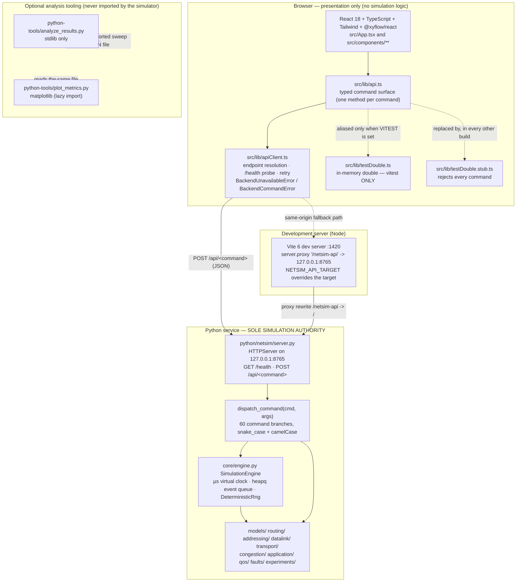

# NETSIM_PROJECT_HANDOFF.md

NetSim: Interactive Computer Network Simulation and Performance Analysis Platform

Engineering handoff document for the next AI engineer.
Written **2026-10-16** against the working tree of commit `d213648f3679b9c94b1326cc065d84640f1d5b9d`
on branch `arena/83075673-cn-project` (`origin/main`), repository `lostpilot404/CN-Project`.

> **Read this first.** Sections 1–5 are enough to understand and run the project. Section 6 is the
> feature inventory, 7–11 are the technical reference, 12–13 are the history and Git state, 14–15
> are the honest limits and the academic framing, and 16–18 are the operating instructions for you.

> **Status (2026-10-16, later than the body below).** The body is preserved as written against
> `d213648`; the "Verified" snapshots in it are dated historical evidence and are deliberately
> not rewritten. Work landed afterwards on `arena/541edc3e-cn-project` (Phases A–I, then the
> residual pass) changed several things the body describes: live forwarding now dispatches
> Dijkstra **and** Bellman-Ford under the active `set_forwarding_policy`, keyboard connect
> exists on the topology canvas, 9 workspace interiors were individually refreshed, and the
> test counts moved on (final: 217 Python / 83 tools / 123+11 frontend / 11 live / 24+3
> Playwright). **For current behaviour and the final verified counts, read
> `FINAL_ENGINEERING_REPORT.md` (incl. §9 addendum) first** — it supersedes this document where
> they disagree; this document remains the deepest technical reference.

## Evidence labels used throughout

| Label | Meaning |
|---|---|
| **Verified** | Directly executed in this environment on the current tree; the command and its result are quoted. |
| **Code-inspected** | Supported by reading the implementation; not executed. |
| **Reported historically** | Recorded in a previous report, PR body or commit message; **not** re-executed here. |
| **Unverified** | No evidence found. Treated as unknown, not as false. |
| **Known limitation** | An acknowledged restriction or incomplete capability. |

Nothing in this document is upgraded from *reported historically* to *verified* without a command
that produced it. Where a document and the code disagree, the code wins and the disagreement is
recorded (see §12 and §14).

## Contents

1. [Project identity and executive summary](#1-project-identity-and-executive-summary)
2. [Current verified project status](#2-current-verified-project-status)
3. [Repository map and navigation guide](#3-repository-map-and-navigation-guide)
4. [Architecture and authority boundaries](#4-architecture-and-authority-boundaries)
5. [Setup and execution instructions](#5-setup-and-execution-instructions)
6. [Complete feature inventory](#6-complete-feature-inventory)
7. [Algorithms and protocol behavior](#7-algorithms-and-protocol-behavior)
8. [API contract reference](#8-api-contract-reference)
9. [Frontend architecture and user-interface map](#9-frontend-architecture-and-user-interface-map)
10. [Testing, type checking, linting, accessibility](#10-testing-type-checking-linting-accessibility)
11. [Experiment tools and data formats](#11-experiment-tools-and-data-formats)
12. [Critical defects fixed and relevant history](#12-critical-defects-fixed-and-relevant-history)
13. [Current Git and release status](#13-current-git-and-release-status)
14. [Known limitations and unresolved risks](#14-known-limitations-and-unresolved-risks)
15. [Academic objectives and syllabus coverage](#15-academic-objectives-and-syllabus-coverage)
16. [How a new AI should safely work on this repository](#16-how-a-new-ai-should-safely-work-on-this-repository)
17. [Exact first commands to run](#17-exact-first-commands-to-run)
18. [Carry-forward summary](#18-carry-forward-summary)

- [Appendix A — evidence log for this document](#appendix-a--evidence-log-for-this-document)
- [Appendix B — mutable state you must re-check](#appendix-b--mutable-state-you-must-re-check)

---

## 1. Project identity and executive summary

| Field | Value | Evidence |
|---|---|---|
| Product name | NetSim — Interactive Computer Network Simulation and Performance Analysis Platform | **Verified** (`README.md`, `package.json` name `netsim`) |
| Version | `0.9.0` (Python package, npm package and the `/health` payload all agree) | **Verified** |
| Course context | Computer Networks coursework (B.Tech CSE, syllabus code `BCSE308L` is named in the historical `PRD.md`) | **Reported historically** in planning docs; **Code-inspected** in `python/netsim/server.py` default project description `"B.Tech CSE Network Simulation Studio"` |
| Team | Srikiran Vavilala (24BCE2215), Dhruv Shaklya (24BCE2211), Prince (24BDS0153) | **Reported historically** (supplied with this task); not found inside the repository — see §15 |
| Current release | No tagged release, no deployment, no packaged artefact. The deliverable is the source tree plus the running pair of processes. | **Verified** (`git tag` empty, no CI workflow, no `dist/` committed) |

### What the system is

Two processes (a browser front-end and a Python simulation service) plus a set of standalone
analysis scripts:

1. **Authoritative simulation core and HTTP API — `python/netsim/` (≈13 k lines).** A
   discrete-event simulator with an integer-microsecond virtual clock, its own priority event
   queue, models for nodes/interfaces/links/queues/packets, and per-family modules for routing
   (Dijkstra, Bellman-Ford), addressing (IPv4, IPv6, VLSM, NAT), data link (Hamming, CRC, Internet
   checksum, sliding window, Go-Back-N, Selective Repeat, ALOHA, CSMA, CSMA/CD), transport (TCP,
   UDP, congestion control), application protocols (DNS, HTTP, FTP, SMTP, SNMP), QoS metrics,
   fault injection and experiment sweeps. Served by a standard-library `HTTPServer` on
   `127.0.0.1:8765`.
2. **Presentation layer — `src/` (React 18 + TypeScript + Tailwind + `@xyflow/react`).** Ten
   workspaces that collect parameters, issue `POST /api/<command>` calls and render exactly what
   comes back. It contains **no** networking algorithms and **no** fallback engine.
3. **Optional tooling — `python-tools/`.** Two standalone scripts that read an exported sweep JSON
   and print a statistics table or draw a PNG. The simulator never imports them.

### The single most important architectural fact

**Python is the sole simulation authority. There is no second engine and no runtime fallback.**

This is not a slogan: it is enforced in three places that a newcomer should verify before touching
anything (`vite.config.ts` alias, `src/lib/api.ts` browser-only path, and the integration test that
asserts `getSimulationAuthority() === 'python'`). The Rust/Tauri runtime that once shipped a
complete duplicate simulator **was removed**, and §12 records why that mattered.

---

## 2. Current verified project status

All commands below were executed on **2026-10-16** against `d213648` in this sandbox with
Python 3.11.2, Node v22.22.3, npm 10.9.8. See [Appendix A](#appendix-a--evidence-log-for-this-document)
for the raw evidence.

### 2.1 Results obtained today (current tree)

| Check | Command | Result | Label |
|---|---|---|---|
| Engine tests | `.venv/bin/python -m pytest python/tests -q` | **154 passed in 1.73 s** | **Verified** |
| Utility tests | `.venv/bin/pytest python-tools/tests -q` | **80 passed in 5.61 s** — *only after* `pip install -r python-tools/requirements.txt` | **Verified** |
| Utility coverage | `.venv/bin/python -m pytest python-tools/tests -q --cov=python-tools` | 99% total (736 statements, 3 missed); `analyze_results.py` 99%, `plot_metrics.py` 99% | **Verified** |
| Python lint | `.venv/bin/ruff check .` | `All checks passed!` | **Verified** |
| Python format | `.venv/bin/ruff format --check python/ python-tools/` | `71 files already formatted` | **Verified** |
| Python types | `.venv/bin/mypy` | `Success: no issues found in 63 source files` — *only after* matplotlib is installed | **Verified** |
| TypeScript | `npx tsc --noEmit` | exit 0, no output | **Verified** |
| Front-end unit/component | `npx vitest run` | **93 passed, 11 skipped (104)** across 13 files (11 passed, 2 skipped) | **Verified** |
| Live integration | `NETSIM_LIVE_API=1 npx vitest run src/integration` | **11 passed (2 files)** against the real Python service | **Verified** |
| Production build | `npm run build` (`tsc && vite build`) | succeeded; Vite build phase **7.41 s**, total wall time 15.05 s; bundle `index-*.js` **1,115.29 kB / 287.67 kB gzip**, CSS 62.72 kB; one chunk-size warning | **Verified** |
| Production bundle hygiene | inspect `dist/assets/testDouble.stub-*.js` | contains only the rejecting stub (`mockInvoke` rejects every command), **no** simulation data | **Verified** |
| `git diff --check` | — | clean | **Verified** |
| Same-origin proxy | `curl http://127.0.0.1:1420/netsim-api/health` and `POST /netsim-api/api/get_simulation_state` | both returned service payloads through the Vite proxy | **Verified** |
| Browser E2E + axe | `LD_LIBRARY_PATH=… NETSIM_CHROMIUM_PATH=… npx playwright test` **with the two servers already running** | **24 passed (59.3 s)** — 22 functional + 2 axe accessibility | **Verified** |
| Browser E2E, cold start | same command with **no** server running (Playwright starts them itself) | **1 failed, 4 passed, 19 did not run** — test `2b` (proxy failover) reports `OFFLINE`. Root cause found; see §14.1 | **Verified (defect)** |

### 2.2 Representative runtime verification performed today

All issued against the live service on `127.0.0.1:8765`:

| Probe | Observed | Label |
|---|---|---|
| `GET /health` | `{"status":"ok","backend":"python","authority":"python-simulation-core","version":"0.9.0","status_detail":"ready","current_time_us":0}` | **Verified** |
| `POST /api/nope` | HTTP 404 `unknown_command` | **Verified** |
| `POST /api/add_node` with body `not json` | HTTP 400 `invalid_json` | **Verified** |
| `POST /api/add_node` with `{"nodeType":"quantum"}` | HTTP 400, message lists accepted node types | **Verified** |
| `POST /api/getProject` (camelCase) | HTTP 200 — both spellings accepted | **Verified** |
| `schedule_fault_command` with an unknown `link_id` | HTTP 400 `"Fault targets unknown link 'nope'"` | **Verified** |
| `schedule_fault_command` with `bit_error` but `error_rate: 5` | HTTP 400 `"'bit_error' requires 'error_rate' between 0.0 and 1.0"` | **Verified** |
| `schedule_fault_command` `link_down` on `link-1`, then `run_simulation_micros` | `link-1` status becomes `down`; after `reset_simulation` it is `up` again | **Verified** |
| `add_static_dnat_rule` with `protocol: "tcp"` (lower case) | HTTP 200 — the historical case-sensitivity defect is gone | **Verified** |
| `simulate_nat_inbound` dst `203.0.113.5:8080` | translated to `192.168.1.10:80`, `direction: "inbound (Static DNAT)"` | **Verified** |
| `simulate_nat_outbound` from `192.168.1.10:51234` | SNAT to `203.0.113.5:49152`, `created_new_mapping: true` | **Verified** |
| `verify_and_correct_hamming("0100011", even)` | `syndrome_value: 3`, `error_position: 3`, corrected codeword present — the historical broken response is fixed | **Verified** |
| `calculate_routing_table` for `node-1` (a PC) | HTTP 400: routing tables are only generated for L3 routing devices | **Verified** |
| `calculate_routing_table` for `node-2`, Dijkstra vs Bellman-Ford | identical `destination`/`next_hop`/`metric` triples for all three destinations (parity) | **Verified** |
| `calculate_crc("1101","1011")` | remainder `001`, transmitted codeword `1101001` | **Verified** |
| `calculate_internet_checksum("0001 F203 F4F5 F6F7")` | `0x220D` (the classic RFC 1071 worked example) | **Verified** |
| `simulate_go_back_n` / `simulate_selective_repeat`, one dropped frame | retransmissions **4** vs **1** — the textbook Go-Back-N/Selective-Repeat difference | **Verified** |
| `simulate_tcp` with `dropped_segments:[1]` | 8 sent / 8 delivered / 1 retransmission (recovered without a timeout) | **Verified** |
| `simulate_udp` with `dropped_segments:[1]` | 4 sent / 3 delivered / **0** retransmissions (loss recorded, not repaired) | **Verified** |
| `run_parameter_sweep_command` executed twice with the same config | byte-identical `aggregated_qos` per point; mean latency 240 797.9 → 74 050.1 → 5 805.0 µs as bandwidth rises 0.5 → 1 → 10 Mbps with 40 packets | **Verified** |
| `python-tools/analyze_results.py` on a live sweep export | printed a per-point table, exit 0 | **Verified** |
| `python-tools/plot_metrics.py` on the same export | wrote a 66,150-byte PNG, exit 0 | **Verified** |
| `python-tools/analyze_results.py` on `{"points":"notalist"}` | exit 1 with a message naming the missing keys | **Verified** |

### 2.3 Historical figures and whether they reproduced

The preceding engineering pass (commit `d24f5b6`, merged as PR #1 → `d213648`) reported the numbers
in the first column. Column three is what happened when this document's author re-ran them:

| Historical claim (source) | Re-run today | Verdict |
|---|---|---|
| Python engine 154 tests | 154 passed | **Reproduced** |
| `python-tools` 80 tests, 99% coverage | 80 passed, 99% (3 missed) | **Reproduced** — but only with `matplotlib` installed (see below) |
| Ruff clean, 71 files formatted | clean, 71 files | **Reproduced** |
| Mypy 0 errors / 63 files | 0 errors / 63 files | **Reproduced** — requires matplotlib installed |
| TypeScript clean | clean | **Reproduced** |
| Front-end 93 passed, 11 skipped | 93 passed, 11 skipped | **Reproduced** |
| Live service integration 11 passed | 11 passed | **Reproduced** |
| Playwright 24 passed incl. accessibility | 24 passed **when the servers are pre-started**; **1 failed / 19 not run on a cold start** | **Partially reproduced — see §14.1** |
| Accessibility: 0 axe violations over 9 workspaces and 23 sub-views | both axe tests passed in the 24-test run | **Reproduced** |
| Production build ≈6.70 s | Vite phase 7.41 s (different machine, same build passes) | **Reproduced within noise** |

> **Dependency trap found while verifying this document.** A venv containing only
> `pytest ruff mypy` (the command printed in `README.md`) will fail `python-tools/tests` with
> **21 failures** (`ModuleNotFoundError: No module named 'matplotlib'`) and will fail `mypy` with
> **2 errors** (`Cannot find implementation or library stub for module named "matplotlib"`).
> Both problems disappear after `pip install -r python-tools/requirements.txt`. This is a real
> setup defect in the README's quickstart, recorded in §14.2.

### 2.4 What is **not** verified

- Screen-reader behaviour, keyboard-only walkthroughs and hover/focus contrast under a tool
  (**Unverified**; axe audits the rendered state only).
- Any browser other than the Chromium build used here (Firefox/WebKit projects do not exist in
  `playwright.config.ts`).
- Windows and macOS (**Unverified**; this environment is Linux).
- Chrome DevTools **panel** interaction (**Unverified** in the previous audit too; CDP-level
  inspection was what was actually performed).
- Bit-exact parity with the historical Rust engine's RNG stream (**Unverified and not claimed**).
- Any deployment, packaging or CI pipeline (**Unverified**; none exists in the repository).

---

## 3. Repository map and navigation guide

166 tracked files. Root holds the front-end, the docs, the test suites and both Python trees.

```text
CN-Project/
├── README.md                     current entry point (architecture, setup, verification table)
├── ARCHITECTURE.md               component-level architecture (rewritten for the Python stack)
├── ALGORITHMS.md                 formula reference the Python code is written against
├── TESTING.md                    test strategy, layers, commands, known blind spots
├── USER_GUIDE.md                 end-user walkthrough of the real (web) UI
├── QUALITY_AUDIT_REPORT.md       78 kB hostile audit: 19 defects, evidence, unverified list
├── NETSIM_PROJECT_HANDOFF.md     this document
├── PRD.md · SRS.md · MASTER_SPECIFICATION.md · ANTIGRAVITY_PROMPT.md
│                                 HISTORICAL planning docs, each carrying a superseded banner
├── PROJECT_REPORT.md             HISTORICAL academic report (Rust-era abstract)
├── walkthrough.md                HISTORICAL Phase 7 record (Rust-era)
├── package.json · package-lock.json · tsconfig.json · vite.config.ts
├── playwright.config.ts · tailwind.config.js · postcss.config.js · index.html
├── pyproject.toml               pytest paths, ruff config, mypy config (engine + tools)
├── python/
│   ├── netsim/                  AUTHORITATIVE simulation core + HTTP service
│   │   ├── server.py            1,132 lines: dispatch table, validation, error mapping
│   │   ├── core/                clock.py events.py engine.py queue.py delays.py rng.py
│   │   │                        metrics.py schema.py
│   │   ├── models/              node.py interface.py link.py packet.py project.py history.py
│   │   ├── routing/             graph.py dijkstra.py bellman_ford.py table.py
│   │   ├── addressing/          ipv4.py ipv6.py vlsm.py nat.py
│   │   ├── datalink/            hamming.py crc.py checksum.py flow_control.py mac.py
│   │   ├── transport/           __init__.py tcp.py udp.py
│   │   ├── congestion/          cwnd.py
│   │   ├── application/         __init__.py dns.py http.py ftp.py smtp.py snmp.py
│   │   ├── qos/                 metrics.py aggregation.py
│   │   ├── faults/              model.py
│   │   └── experiments/         config.py sweep.py runner.py results.py
│   └── tests/                   7 modules, 154 collected cases (incl. in-process HTTP tests)
├── python-tools/                optional standalone analysers + their own test suite
├── src/                         React front-end (UI only)
│   ├── App.tsx                  shell: workspace switch, health subscription, clock refresh
│   ├── components/              layout/ topology/ simulation/ timeline/ inspector/
│   │                            visualization/ routing/ addressing/ datalink/ transport/
│   │                            application/ experiments/
│   ├── lib/apiClient.ts         endpoint resolution, health probe, retry, error types
│   ├── lib/api.ts               typed command surface (one method per backend command)
│   ├── lib/testDouble.ts        in-memory double used ONLY by vitest (2892 lines)
│   ├── lib/testDouble.stub.ts   rejecting stub that replaces the double in every other build
│   ├── types/                   14 DTO modules mirroring the server payloads
│   └── *.test.ts(x)             13 test files (acceptance suites per phase)
└── e2e/                         netsim.spec.ts (22 tests) · a11y.spec.ts (2 axe tests)
```

### Navigation table — the files to open first

| File | Purpose | Inspect it when… |
|---|---|---|
| [`python/netsim/server.py`](python/netsim/server.py) | The whole API: `dispatch_command` (60 branches), `SessionState`, `create_default_project`, validation helpers, `NetSimRequestHandler`, error mapping | You need to add/alter a command, change validation, or debug an HTTP status code |
| [`python/netsim/core/engine.py`](python/netsim/core/engine.py) | Discrete-event engine: event queue, packet lifecycle, queueing, loss, faults, reset, snapshot | Anything about simulation timing, packet state, drop accounting or faults |
| [`python/netsim/core/rng.py`](python/netsim/core/rng.py) | `DeterministicRng` (wraps `random.Random`) | You are reasoning about reproducibility or randomness |
| [`python/netsim/core/events.py`](python/netsim/core/events.py) | `SimEvent`, `SimEventType`, the `{type, data}` envelope, event ordering | Timeline/event-shape work |
| [`python/netsim/models/packet.py`](python/netsim/models/packet.py) | `PacketState` (with terminal-drop semantics), five header layers, hop records | Packet state or inspector work |
| [`python/netsim/core/metrics.py`](python/netsim/core/metrics.py) · [`qos/metrics.py`](python/netsim/qos/metrics.py) | Simulation counters and QoS derivation | Metric definitions, loss categories, jitter, utilisation |
| [`python/netsim/experiments/runner.py`](python/netsim/experiments/runner.py) | `SingleRunParams`, `run_single_simulation`, sweep and comparison orchestration | Experiment behaviour, seeding, route-change records |
| [`python/netsim/faults/model.py`](python/netsim/faults/model.py) | `FaultType` (8 kinds), `FaultSchedule`, target/label helpers | Fault payloads or new fault kinds |
| [`src/lib/apiClient.ts`](src/lib/apiClient.ts) | Endpoint candidates, `/health` probe, retry, `BackendUnavailableError`, `BackendCommandError` | Connectivity, proxy, offline-state or failover work |
| [`src/lib/api.ts`](src/lib/api.ts) | One typed method per command; the only place the UI may execute a command | Adding a UI-driven command |
| [`vite.config.ts`](vite.config.ts) | Ports 1420, `allowedHosts`, watch ignores, `/netsim-api` proxy, the test-double alias | Dev-server, proxy or "why is my HMR reloading" work |
| [`playwright.config.ts`](playwright.config.ts) | Both `webServer` entries, `NETSIM_CHROMIUM_PATH` escape hatch, ports/seeds via env | Browser-suite failures (§14.1 lives here) |
| [`python/tests/test_protocol_regressions.py`](python/tests/test_protocol_regressions.py) | Hand-computed expectations for delay, flow control, TCP, determinism | You changed engine behaviour and need to know what is load-bearing |
| [`src/integration/liveApi.test.ts`](src/integration/liveApi.test.ts) | Real-service assertions incl. the authority check | You need proof that the UI talks to Python, not a double |
| [`e2e/a11y.spec.ts`](e2e/a11y.spec.ts) | The workspace/sub-view lists axe audits (9 + 23) | Accessibility coverage questions |
| [`QUALITY_AUDIT_REPORT.md`](QUALITY_AUDIT_REPORT.md) | The 19 defects with reproduction and re-test evidence | Before you "fix" something — it may already have a documented history |

---

## 4. Architecture and authority boundaries

### 4.1 Verified architecture



### 4.2 Facts a newcomer must not get wrong

| Fact | Evidence |
|---|---|
| Python executes every simulation; the front-end renders results | **Code-inspected**: `src/lib/api.ts` `callCommand` → `callBackend`; no arithmetic on simulation quantities outside formatting |
| The front-end has no reachable second engine | **Code-inspected + Verified**: `vite.config.ts` aliases `@netsim/test-double` to the rejecting stub unless `VITEST` is set; the production bundle contains only the 144-byte stub (inspected in `dist/`) |
| When the service is down, the UI reports it — it never invents data | **Verified** in Playwright test 2 (`Backend Offline` + `OFFLINE`, and the badge `title` names the server command) |
| The service binds loopback only | **Code-inspected**: `HTTPServer(("127.0.0.1", port), …)` in `run_server` |
| Only two HTTP routes exist | **Code-inspected**: `do_GET` serves `/health` and `/api/health`; everything else 404s. Every command is `POST /api/<command>` (a bare `/<command>` is also accepted by the path parser) |
| There is exactly one process-wide session | **Code-inspected**: module-level `SESSION = SessionState()` — one project, one engine, one NAT table map, shared by all clients. There is no per-user or per-connection state |
| Simulation time is virtual and integer-microsecond | **Verified**: `run_simulation_micros` with `duration_us: 5000` advanced exactly one event because the default project had nothing else scheduled; **Code-inspected** `SimTime` (`core/clock.py`) |
| Rust/Tauri is gone | **Verified**: no `src-tauri/`, no `Cargo.toml`, no `@tauri-apps/*` in `package.json`, no `tauri` string in the built bundle |

### 4.3 Request lifecycle (verified end to end)

1. A workspace calls a typed wrapper in `src/lib/api.ts`, e.g. `api.stepSimulation()`.
2. `callBackend` resolves an endpoint: a configured `VITE_NETSIM_API_URL` if present, otherwise
   `http://127.0.0.1:8765` when the page is served from loopback, otherwise the same-origin
   `/netsim-api` **first** (proxied deployments) with loopback second. Reachability is probed with
   `GET /health` and cached in `resolvedEndpoint`.
3. `POST <endpoint>/api/<command>` with a JSON object body.
4. `NetSimRequestHandler.do_POST` parses the body, unwraps an optional `{"args": {...}}` wrapper,
   dispatches, and maps outcomes: `UnknownCommandError` → 404, `CommandError`/`ValueError` → 400,
   anything else → 500 with a generic message (`KeyError`/`TypeError` deliberately fall through to
   500 because they indicate core defects, not bad input).
5. Success returns `{"status": "ok", "result": …}`.
6. On a transport-level failure the client clears the cached endpoint, re-probes and retries once;
   on a rejected command the typed error is raised to the caller and surfaced in the UI.

### 4.4 Startup order and process boundaries

| Order | Process | Command | Port | Failure behaviour |
|---|---|---|---|---|
| 1 | Python simulation service | `.venv/bin/python python/netsim/server.py 8765` | `127.0.0.1:8765` | A second instance fails loudly with the OS bind error; it never silently moves ports |
| 2 | Vite dev server | `npm run dev` | `0.0.0.0:1420` (`host: true`, `strictPort: true`, `allowedHosts: true`) | Exits if 1420 is taken |
| — | Vite `/netsim-api` proxy | configured in `vite.config.ts` | — | Target from `NETSIM_API_TARGET`, default `http://127.0.0.1:8765` |

`playwright.config.ts` starts both itself (with `reuseExistingServer: !CI`) using `/health` and the
dev-server URL as readiness probes — read §14.1 before trusting a cold start.

### 4.5 Retired components — do not reintroduce

| Retired | Why | Evidence |
|---|---|---|
| `src-tauri/` (63 `.rs` files, 20,883 lines; 45 engine files / 12,353 lines plus 6,468 lines of Rust tests) | It was a **complete second simulation engine**, not a shell | **Reported historically** in `QUALITY_AUDIT_REPORT.md` §22.1–22.2 (the audit explicitly corrects its own earlier false claim) |
| Root `Cargo.toml`, `.cargo/` | Manifests for that tree | **Verified**: absent today |
| `@tauri-apps/api`, `@tauri-apps/cli`, `npm run tauri` | Runtime/CLI for the removed shell | **Verified**: absent from `package.json` |
| Front-end IPC fallback (`src/lib/tauri.ts` `invoke` branches) | It could silently execute a *different* engine when the Python service was unreachable inside a Tauri window | **Reported historically**; today `src/lib/api.ts` has no such path and `SimulationAuthority = 'python' \| 'test-double'` |
| `TAURI_ENV_*` build variables | Drove the Vite target for the removed shell | **Verified**: absent from `vite.config.ts` |

**Rule:** the only supported deployment is the browser front-end plus the Python service. Do not
add a native shell, a WASM engine, a Node-side simulator or a "temporary" fallback that can produce
simulation results without the Python process.

---

## 5. Setup and execution instructions

### 5.1 Requirements

| Requirement | Version | Evidence |
|---|---|---|
| Python | **3.11 or newer** (`requires-python = ">=3.11"`); verified on 3.11.2 | **Verified** |
| Node.js + npm | Node 22.22.2+ per `package.json` engines and `README.md`; verified on Node v22.22.3 / npm 10.9.8, CI pinned to 22.22.2 (the jsdom 30 / jest-dom 7 line requires ^22.22.2 and does not run on Node 20) | **Verified** |
| A Chromium build | Only for the browser suite. Playwright's own download **fails** in restricted-egress sandboxes (`cdn.playwright.dev` is not reachable here) | **Verified** |
| Cargo / Rust / Tauri | **Not required and not present.** Do not add them | **Verified** |
| Operating system | Linux verified; Windows/macOS untested | **Known limitation** |

The simulation engine is **standard-library only**. `python-tools/requirements.txt` lists exactly
one package (`matplotlib`), imported lazily by the plotter.

### 5.2 Python environment

```bash
cd <repo root>
python3 -m venv .venv
.venv/bin/pip install pytest ruff mypy pytest-cov            # dev tooling
.venv/bin/pip install -r python-tools/requirements.txt       # matplotlib — REQUIRED for the python-tools tests and for a clean mypy run
```

> **Do not skip the second install.** Without matplotlib, `pytest python-tools/tests` reports
> **21 failures** and `mypy` reports **2 errors** (`python-tools/plot_metrics.py:143,146`,
> `import-not-found`). Both are dependency artefacts, not code defects. They were observed and then
> resolved this way on 2026-10-16. (§14.2)

Verified tool versions at the time of writing: pytest 9.1.1, pytest-cov 7.1.0, ruff 0.17.1,
mypy 2.4.0 (compiled), matplotlib 3.11.2.

### 5.3 Front-end dependencies

```bash
npm install        # verified: 289 packages in ~9 s on 2026-10-16
```

Resolved versions observed: Vite 6.4.3, Vitest 3.2.7, React 18.3.1, `@xyflow/react` 12.11.6,
recharts 2.15.4, Tailwind 3.4.19, TypeScript 5.9.3, `@playwright/test` 1.63.0,
`@axe-core/playwright` 4.13.0, jsdom 30.1.2.

### 5.4 Environment variables

| Variable | Consumer | Default | Effect |
|---|---|---|---|
| `VITE_NETSIM_API_URL` | Front-end build/runtime | unset | **Replaces** the candidate list with this single endpoint. Note the trap in §14.1 |
| `NETSIM_API_TARGET` | `vite.config.ts` | `http://127.0.0.1:8765` | Where the dev server proxies `/netsim-api` |
| `NETSIM_LIVE_API=1` | `src/lib/api.ts`, `src/integration/*` | unset | Makes vitest talk to the real service instead of the double |
| `NETSIM_CHROMIUM_PATH` | `playwright.config.ts` | unset | `executablePath` for an existing Chromium, launched with `--no-sandbox --disable-dev-shm-usage --disable-gpu` |
| `NETSIM_API_PORT`, `NETSIM_WEB_PORT` | `playwright.config.ts` | `8765`, `1420` | Ports the harness starts/expects |
| `NETSIM_API_URL` | `e2e/*.spec.ts` | `http://127.0.0.1:8765` | Base URL the browser tests call directly (checks `VITE_NETSIM_API_URL` first) |
| `VITEST` | `vite.config.ts` | set by the runner | Selects the real test double instead of the rejecting stub |
| `CI` | `playwright.config.ts` | unset | Disables `reuseExistingServer`, enables one retry and the HTML report |

No repository file defines any of these; there is no `.env`, and none is needed. **No secrets are
stored in the repository** (verified by scanning tracked sources for key/secret/token patterns —
only tutorial FTP credentials such as `guest@example.com` and a path-traversal test payload match).

### 5.5 Running the application

```bash
# Terminal 1 — authoritative simulation service
.venv/bin/python python/netsim/server.py 8765
# expected log: "NetSim Python Simulation Server listening on http://127.0.0.1:8765"

# Terminal 2 — user interface
npm run dev                       # http://127.0.0.1:1420
```

Health check (**verified**):

```bash
curl -s http://127.0.0.1:8765/health
# {"status":"ok","backend":"python","authority":"python-simulation-core","version":"0.9.0",
#  "status_detail":"ready","current_time_us":0}
```

Open <http://127.0.0.1:1420>. The sidebar footer shows `ONLINE` and `Python core v0.9.0`; the navbar
badge reads `Python Authoritative`. If the badge reads `Backend Offline`, the service is not
reachable — that is the intended behaviour, not a bug.

Proxied/preview access (used when the page is not served from loopback):

```bash
curl -s http://127.0.0.1:1420/netsim-api/health          # verified: proxy round trip
NETSIM_API_TARGET=http://other-host:8765 npm run dev     # point the proxy elsewhere
```

Stopping: `Ctrl-C` in each terminal. Ports to free are 8765 (Python) and 1420 (Vite); a leftover
Vite process is the usual cause of the failure described in §14.1.

### 5.6 Production build

```bash
npm run build        # tsc && vite build   — verified: succeeds
npm run preview      # serves dist/ on :1420 with the same proxy configuration
```

Observed output: `dist/index.html` 0.89 kB, CSS 62.72 kB (11.12 kB gzip),
JS 1,115.29 kB (287.67 kB gzip), plus the 0.14 kB rejecting stub. Rollup warns that the main chunk
exceeds 500 kB; **no code splitting is configured** — bundle size is a known limitation, not a
failure. `sourcemap: false` in `vite.config.ts`.

### 5.7 Tests and quality checks

Exact commands, all re-run today:

```bash
# Python engine (no service needed)
.venv/bin/python -m pytest python/tests -q                       # 154 passed
.venv/bin/pytest python-tools/tests -q                           # 80 passed (needs matplotlib)
.venv/bin/python -m pytest python-tools/tests -q --cov=python-tools   # 99% statement coverage
.venv/bin/ruff check .                                            # All checks passed!
.venv/bin/ruff format --check python/ python-tools/               # 71 files already formatted
.venv/bin/mypy                                                    # Success: 63 source files

# Front-end (no service needed)
npx tsc --noEmit                                                  # clean
npx vitest run                                                    # 93 passed, 11 skipped
npm run build                                                     # succeeds

# Integration against the real service
.venv/bin/python python/netsim/server.py 8765 &                   # service running
NETSIM_LIVE_API=1 npx vitest run src/integration                  # 11 passed
# equivalent npm script: npm run test:live

# Browser end-to-end (Playwright starts both servers itself)
npx playwright install chromium                                   # may fail on restricted egress
npx playwright test                                               # see §14.1 before trusting a cold run
npx playwright test e2e/a11y.spec.ts                              # 2 axe tests only
```

#### Getting a browser where downloads are blocked (verified here)

`npx playwright install chromium` fails with a download error in this sandbox. The workaround
documented in `README.md` — decompress the self-contained Chromium published on npm as
`@sparticuz/chromium` — **was executed successfully today**:

```bash
mkdir -p /tmp/browser && cd /tmp/browser && npm init -y && npm install @sparticuz/chromium
node -e "
const z = require('zlib'), fs = require('fs');
fs.mkdirSync('out', { recursive: true });
for (const name of ['chromium', 'al2023.tar']) {
  fs.writeFileSync('out/' + name, z.brotliDecompressSync(fs.readFileSync('node_modules/@sparticuz/chromium/bin/' + name + '.br')));
}"
chmod +x out/chromium && mkdir -p libs && tar -xf out/al2023.tar -C libs

# then, from the repository root:
LD_LIBRARY_PATH=/tmp/browser/libs/lib NETSIM_CHROMIUM_PATH=/tmp/browser/out/chromium npx playwright test
```

#### Stale Vite dev servers, and why a restart matters before a final run

- `playwright.config.ts` uses `reuseExistingServer: !process.env.CI`. A dev server you left running
  is **silently reused**, together with whatever module graph and optimizer state it has
  accumulated.
- A long-lived server that absorbed dozens of HMR updates, or that was running when a dependency
  was installed, can serve a stale graph. Historically this produced
  `1 failed, 4 passed, 19 did not run` (test `2b` stuck reporting a pre-probe status) which
  disappeared after restarting the dev server — recorded in `QUALITY_AUDIT_REPORT.md` §23.4.
- The original cause of reload-during-install churn was fixed: `vite.config.ts` now ignores
  `**/.venv/**`, `**/venv/**`, `**/__pycache__/**`, `**/.pytest_cache/**`, `**/.ruff_cache/**`,
  `**/.git/**`, so installing a Python package or running the test suite no longer reloads the
  browser mid-edit. That fix is **Code-inspected** and **Reported historically** (defect 14).
- How to recognise a stale server: the Playwright startup tests fail while a manual
  `curl http://127.0.0.1:1420/` and `curl http://127.0.0.1:8765/health` both succeed; or the
  sidebar badge stays `UNKNOWN`/`CHECKING`; or your source edit is not reflected in the browser
  after a save. Remedy: kill the Vite process (and the Python service if you changed engine code),
  start both fresh, then run the suite.
- §14.1 documents a **second, independent** cause of the same test failing that is *not* a stale
  server. Restarting alone will not fix it when Playwright starts the servers itself.

---

## 6. Complete feature inventory

Status vocabulary: **Implemented + verified** (executed here or in the browser suite),
**Implemented, not adequately tested**, **Partial**, **Absent**, **Not verified**.

### 6.1 Topology, devices, links, interfaces

| Feature or workspace | Purpose | Implementation location | Verification status | Known limitations |
|---|---|---|---|---|
| Topology canvas (workspace 1) | Render the project graph, drag nodes, draw links, select elements, minimap, zoom | `src/components/topology/TopologyCanvas.tsx`, `CustomNode.tsx`, `DevicePalette.tsx`, `PropertyEditor.tsx`; `POST api/add_node \| add_link \| update_node \| update_link \| remove_*` in `python/netsim/server.py` | **Implemented + verified** — Playwright tests 3 and 4 add a device and connect two nodes by dragging, then confirm against `get_project` | Node positions are persisted through `update_node {position}`; the canvas is not keyboard-editable beyond focusable buttons |
| Device palette (6 device types) | Create PC, router, switch, server, wireless AP, generic host | `DevicePalette.tsx` (`pc`, `router`, `switch`, `server`, `access_point`, `generic`); `NodeType` enum in `python/netsim/models/node.py` | **Implemented + verified** (palette clicks persisted by the service) | Node types are labels/roles: only routers are treated as L3 transit for routing tables (`RoutingGraph.is_routing_device`) |
| Node configuration | Rename, set state (`up`/`down`/`degraded`), inspect interfaces | `PropertyEditor.tsx`; `update_node` branch | **Implemented + verified** | Duplicate labels are allowed (ids are authoritative) |
| Interface configuration | IPv4, subnet mask, IPv6, MAC, `up`/`down` per interface | `PropertyEditor.tsx`; `update_interface` branch; `python/netsim/models/interface.py` | **Implemented + verified** | Interfaces are auto-generated per node type by `Node.generate_default_interfaces` |
| Automatic port provisioning | `add_link` creates a new port when all existing ports are busy | `provision_interface`, `resolve_link_endpoint`, `MAX_INTERFACES_PER_NODE = 24` in `server.py` | **Implemented + verified** (regression test `test_regression_a_link_can_be_added_even_when_every_port_is_in_use`; the historical "no free interface" defect is gone) | Hard cap of 24 interfaces per node; an explicitly named **busy** port is still rejected |
| Link parameters | Bandwidth (bps), propagation delay (µs), loss probability, bit-error rate, queue capacity, status | `python/netsim/models/link.py`; `add_link`/`update_link`; `Link.validate()` | **Implemented + verified** (`test_bandwidth_scales_only_the_serialisation_term`, queue/ber paths in the engine) | No duplex/mismatch modelling; no MTU |
| Link removal / node removal | Delete topology elements with validation | `remove_link`, `remove_node` branches | **Implemented + verified** (`test_regression_remove_node_requires_an_identifier`, `..._rejects_an_unknown_identifier`) | Deleting a node detaches its links; no cascade confirmation in the UI |
| Undo / redo | Snapshot-stack history for topology mutations | `SESSION.push_undo/reset_engine` + `undo_topology`/`redo_topology`/`get_topology_history_status` in `server.py` | **Implemented + verified** (Playwright exercises the buttons; `src/Phase3Acceptance.test.ts` asserts the status transitions) | Depth capped at 50; **`python/netsim/models/history.py` (`TopologyHistory`) is not used by the server or the UI** — a navigation trap, see §14.9 |

### 6.2 Simulation, events, inspection

| Feature or workspace | Purpose | Implementation location | Verification status | Known limitations |
|---|---|---|---|---|
| Discrete-event engine | Virtual µs clock, priority event queue, single-step/burst/drain execution | `python/netsim/core/engine.py` (`SimulationEngine`, `step`, `run_until`, `run_all`, `pause`), `core/clock.py`, `core/events.py` | **Implemented + verified** (154 engine tests; `test_link_queues_pipeline_rather_than_serialising_end_to_end`, `test_identical_configuration_produces_identical_results`) | One session process-wide; no parallel runs inside one process |
| Simulation controls | Pause, Run 50 ms, Run All, Step Event, Reset, Inject Packet | `src/components/simulation/ControlBar.tsx` + `App.tsx` handlers; `pause_simulation`, `run_simulation_micros`, `run_simulation_until_empty`, `step_simulation`, `reset_simulation` | **Implemented + verified** (Playwright tests 5, 6 including engine-measured delivery) | "Run 50ms" is a fixed 50 000 µs burst; there is no arbitrary-duration control in the topology view |
| Event timeline | Filterable, colour-coded event log with layer/protocol/status | `src/components/timeline/EventTimeline.tsx`, `EventFilters.tsx`, `TimelineDrawer.tsx`, `EventDetail.tsx`; `src/types/events.ts` | **Implemented + verified** (`EventContract.test.tsx`, 5 tests; the historical `Object.keys(event_type)[0]` defect is fixed — the component reads the `{type, data}` envelope) | Shows the engine's most recent 50 processed events (`getSnapshot` slices `processed_events[-50:]`) |
| Packet inspector | Five-layer header breakdown (application, transport, network, data link, physical) | `src/components/inspector/PacketInspector.tsx`, `LayerCard.tsx`; data from `get_packet_details` | **Implemented + verified** (Playwright test 7 compares the UI against `get_packet_details`) | Header values for injected packets come from `engine.inject_packet` templates (e.g. static TTL 64), not from a protocol stack that computes them |
| Packet journey / path visualisation | Hop-by-hop history with per-state records | `src/components/visualization/PacketJourney.tsx`, `PacketMarker.tsx`; `Packet.hop_history`, `journey_hops`, `planned_route` | **Implemented + verified** (a delivered packet showed hops `node-1 … node-2 … node-3` with per-state records) | Transit forwarding picks a next link by a heuristic (see §7.5), so `planned_route` is indicative, not a routing-table lookup |
| Encapsulation viewer | Show the nested header stack of the selected packet | `src/components/visualization/EncapsulationViewer.tsx` | **Implemented + verified** (Playwright test 7 / `data-testid="encapsulation-viewer"`) | Read-only |
| Simulation state snapshot | Time, status, counters, queue snapshots, packet list | `engine.get_snapshot`; `get_simulation_state` | **Implemented + verified** | Packet list is unbounded within a run (no paging) |
| Backend-offline handling | Report a missing service instead of substituting data | `src/lib/apiClient.ts`, `src/components/layout/Navbar.tsx`, `Sidebar.tsx` | **Implemented + verified** (Playwright test 2 asserts `Backend Offline` + `OFFLINE` and that the badge names the start command) | The periodic clock refresh is silent by design; a dropped service shows as a stale clock until the next explicit action |

### 6.3 Addressing, subnets, NAT

| Feature or workspace | Purpose | Implementation location | Verification status | Known limitations |
|---|---|---|---|---|
| IPv4 subnet calculator (workspace 3, sub-view 1) | Network/broadcast/first/last usable, host counts, mask, wildcard, class, binary | `python/netsim/addressing/ipv4.py` (`calculate_subnet`, `parse_cidr_or_ip_mask`, `prefix_to_mask`, `classify_ip`); command `calculate_ipv4_subnet` | **Implemented + verified** (`test_ipv4_subnet_math_matches_hand_calculations`, `test_ipv4_edge_prefix_lengths`; live probe of `192.168.1.130/26` → network `192.168.1.128`, usable 62) | `/31` and `/32` are special-cased (2 and 1 usable addresses) |
| Equal subnet splitting | Split a base CIDR into N equal subnets | `split_equal_subnets`; command `split_ipv4_subnet` | **Implemented + verified** (`test_equal_subnet_split_produces_contiguous_blocks`) | Requires `new_prefix > original_prefix` |
| True VLSM allocator (sub-view 2) | Largest-first allocation from a base block with waste accounting | `python/netsim/addressing/vlsm.py` (`allocate_vlsm`); command `allocate_vlsm_subnets` | **Implemented + verified** (`test_vlsm_allocates_largest_first_without_overlap`; live probe `10.0.0.0/24` + 100/50/20 hosts → `/25,/26,/27`, 85.16% utilisation) | Raises when a requirement cannot fit (`Address space exhausted!`); no re-allocation/optimisation of an existing plan |
| Topology IP auditor (sub-view 3) | Detect duplicate IPv4 addresses across interfaces | `detect_duplicate_ips`; command `detect_duplicate_ips_command` | **Implemented**, **Partially verified** (command wired, types present; no dedicated Python test found for the duplicate path) | Only exact duplicates; no overlap-between-subnets check |
| IPv6 inspector (sub-view 4) | Validate, expand, canonicalise (RFC 5952), classify scope/prefix | `python/netsim/addressing/ipv6.py` (`parse_ipv6_details`, `format_rfc5952_canonical`, `classify_ipv6_scope`); command `validate_ipv6_address` | **Implemented + verified** (live probe of `2001:0db8:…:8329` → valid, scope "Documentation Prefix (2001:db8::/32)") | **No IPv6 routing, no IPv6 addressing plan, no IPv6 header simulation** — inspection only |
| NAT / NAPT (sub-view 5) | Stateful SNAT table with dynamic port pool, timeouts, static DNAT (port forwarding), inbound/outbound translation traces | `python/netsim/addressing/nat.py` (`NatTable.translate_outbound`, `translate_inbound`, `allocate_dynamic_port`, `expire_entries`); commands `get_or_create_nat_table`, `add_static_dnat_rule`, `simulate_nat_outbound`, `simulate_nat_inbound` | **Implemented + verified** (regressions `test_regression_nat_protocol_is_case_insensitive`, `test_regression_nat_outbound_and_inbound_translate`, `test_regression_new_project_does_not_inherit_nat_state`; live probes of SNAT and DNAT today) | NAT is a **table/translation model**, not wired into the packet path; the diagrams are explanatory |
| Port forwarding | Static DNAT rule with protocol/port match, collision detection | `NatTable.add_static_dnat_rule` | **Implemented + verified** | One rule per (protocol, public port); no wildcard/range rules |

### 6.4 Routing

| Feature or workspace | Purpose | Implementation location | Verification status | Known limitations |
|---|---|---|---|---|
| Dijkstra (link-state) routing table (workspace 2, sub-view 1) | Shortest-path tree, next hop, interface, metric, path | `python/netsim/routing/dijkstra.py`, `routing/graph.py`, `routing/table.py`; command `calculate_routing_table {algorithm: dijkstra}` | **Implemented + verified** (`test_dijkstra_prefers_two_fast_hops_over_one_slow_hop`, `test_dijkstra_and_bellman_ford_agree_on_every_destination`, live parity probe) | Only L3 routing devices (routers) may own a table; a PC request returns HTTP 400 (verified) |
| Bellman-Ford (distance vector) routing table (sub-view 2) | Iterative DV computation with the same output contract | `python/netsim/routing/bellman_ford.py` (`compute_bellman_ford_shortest_paths`) | **Implemented + verified** (parity with Dijkstra verified today) | Iteration cap is the node count; no split-horizon/poison-reverse modelling |
| Convergence telemetry | Round-by-round DV update trace to convergence | `bellman_ford.simulate_distance_vector_convergence`; command `simulate_routing_convergence` | **Implemented + verified** (Playwright test 9 asserts real round counts) | DV only (no link-state flooding rounds) |
| Routing metrics | Hop count, propagation delay, inverse bandwidth | `RoutingGraph.from_project(metric_type)`; `MetricType` enum | **Implemented + verified** (`test_hop_count_metric_prefers_the_direct_link`, `test_propagation_delay_metric_avoids_the_slow_direct_link`, `test_inverse_bandwidth_metric_matches_the_formula`) | Metrics are computed on the static project topology, not on measured load |
| Route change records under faults | Before/after path, reachability and affected links per fault | `RouteChangeRecord` in `python/netsim/faults/model.py`; `experiments/runner.run_single_simulation` | **Implemented + verified** (`test_parity_03_link_down_fault`, `test_parity_06_alternate_route`) | Produced for experiments; not surfaced as a dedicated UI table |
| Dynamic routing that steers live traffic | Traffic following recomputed routes after a fault | — | **Absent** | The engine forwards packets with a link-selection heuristic (§7.5) and does not consult `routing/`; faults change link status, not the packet path |

### 6.5 Data link: error control, flow control, MAC

| Feature or workspace | Purpose | Implementation location | Verification status | Known limitations |
|---|---|---|---|---|
| Hamming code encode/correct (workspace 5 → Error Control) | Parity-bit placement, parity computation, SECDED word, syndrome decode, single-bit correction | `python/netsim/datalink/hamming.py` (`encode_hamming`, `verify_and_correct_hamming`, `calculate_required_parity_bits`); commands `calculate_hamming_encode`, `verify_and_correct_hamming` | **Implemented + verified** — `1011` → `0110011`; a flipped bit reports `syndrome 011`, `error_position 3`, corrected word, all 12 declared fields (the historical 500-error defect is fixed) | Double-bit errors are detected-by-overall-parity only, not corrected; the parity mode is even/odd |
| CRC polynomial division | Augment with zeros, modulo-2 division with step-by-step detail, remainder, transmitted frame; verify | `python/netsim/datalink/crc.py` (`perform_modulo2_division`, `calculate_crc`, `verify_crc`, presets CRC-8/16-IBM/16-CCITT/32-IEEE); commands `calculate_crc`, `verify_crc` | **Implemented + verified** (`1101` / `1011` → remainder `001`, codeword `1101001`) | The API takes an explicit polynomial string; the preset helper `crc_compute`/`crc_verify` is not exposed through the server |
| Internet checksum (RFC 1071) | 16-bit word sum, carry folding, one's-complement, verification | `python/netsim/datalink/checksum.py` (`calculate_internet_checksum`, `verify_internet_checksum`, `internet_checksum`); commands `calculate_internet_checksum`, `verify_internet_checksum`, `calculate_simple_checksum` | **Implemented + verified** (`0001 F203 F4F5 F6F7` → `0x220D`) | Big-endian 16-bit words; odd-length input pads per the implementation |
| Sliding window / Go-Back-N / Selective Repeat | Windowed sender/receiver state machines with configurable loss/corruption/ACK loss | `python/netsim/datalink/flow_control.py` (`simulate_flow_control`, `simulate_sliding_window`, `simulate_go_back_n`, `simulate_selective_repeat`, `SenderWindowState`, `ReceiverWindowState`, `FlowControlMetrics`); commands `simulate_*` | **Implemented + verified** (`test_flow_control_loss_recovery_matches_the_protocol_definition` — 4 vs 1 retransmissions; `test_flow_control_stalls_at_the_window_size` — 92 ms resume; live probe reproduced 4 vs 1) | Frame-level model over an abstract channel, not the packet engine; with `window < 2a+1` the sliding-window run stalls by design |
| Pure ALOHA / Slotted ALOHA | Contention model with collisions, retries, backoff, efficiency | `python/netsim/datalink/mac.py` (`simulate_pure_aloha`, `simulate_slotted_aloha`); commands `simulate_pure_aloha`, `simulate_slotted_aloha` | **Implemented + verified** (dispatch + `test_parity_12_aloha`; live run produced 10 successes / 24 collisions) | `max_steps = 15 000` guard; efficiency values depend on `offered_load_g` (default 1.5) |
| CSMA, CSMA/CD | Carrier sense with 1-persistent / non-persistent / p-persistent, deferral, collision detect, binary backoff, jam signal | `mac.py` (`simulate_csma`, `simulate_csma_cd`); commands `simulate_csma`, `simulate_csma_cd` | **Implemented + verified** (Playwright test 13 runs all four MAC protocols; live CSMA/CD run completed in 102 750 µs vs ALOHA 429 820 µs for the same offered frames) | A simulation model, not IEEE 802.3: slot time is `max(10, 2·prop_delay)`, jam duration `max(10, prop_delay)` |
| Circuit switching | — | — | **Absent** — the string "circuit" does not appear anywhere in `python/` or `src/`, although `ALGORITHMS.md` §16 describes it as a requirement | Do not describe NetSim as supporting circuit switching |

### 6.6 Transport and congestion

| Feature or workspace | Purpose | Implementation location | Verification status | Known limitations |
|---|---|---|---|---|
| TCP studio (workspace 6, sub-view 1) | Three-way handshake, byte-oriented transfer, MSS, receive window, ACKs, fast retransmit, timeouts, RTT telemetry | `python/netsim/transport/tcp.py` (`simulate_tcp`), `transport/__init__.py` (`TransportConfig`, `RttEstimator`, `TransportMetrics`, `resolve_route_and_links`); command `simulate_tcp` | **Implemented + verified** (`test_tcp_slow_start_doubles_the_in_flight_window_each_round`, `test_tcp_loses_one_segment_and_recovers_with_one_retransmission`; live run: 8/8 delivered with one retransmission) | Simplified: no SACK, no window scaling, no delayed ACK timer, no reassembly of out-of-order data beyond buffering; `maximum_retries` default 5 |
| UDP studio (sub-view 2) | Connectionless send with loss accounted and no recovery | `python/netsim/transport/udp.py` (`simulate_udp`); command `simulate_udp` | **Implemented + verified** (`test_parity_15_udp_loss`; live run: 4 sent / 3 delivered / 0 retransmissions) | No checksum-level verification, no pacing |
| Congestion control (sub-view 3) | Slow start, congestion avoidance (+1 MSS/RTT), fast recovery, timeout recovery, cwnd timeline | `python/netsim/congestion/cwnd.py` (`CongestionController.on_new_ack`, `on_duplicate_ack`, `on_timeout`, `on_packet_loss`, `CwndPoint`); surfaced through `simulate_tcp_congestion` | **Implemented + verified** (`test_tcp_congestion_avoidance_adds_one_mss_per_round_trip`; Playwright test 15 asserts slow start then additive increase) | EDU model: ssthresh default 16 MSS, initial cwnd 1 MSS, cwnd floor 1 MSS; no CUBIC/BBR, no RTT-based pacing |
| TCP vs UDP comparison studio (sub-view 4) | Side-by-side run of both protocols over the same topology | `src/components/transport/TransportWorkspace.tsx` (`comparison-studio-container`); uses `simulate_tcp` + `simulate_udp` | **Implemented + verified** by the workspace tests and Playwright coverage of the transport tab | **Not included in the axe sub-view list** in `e2e/a11y.spec.ts` — an accessibility coverage gap |
| Link queues and drop-tail | Bounded FIFO per link with overflow accounting | `python/netsim/core/queue.py` (`LinkQueue`, `QueueFullError`), engine `_process_event` | **Implemented + verified** (`test_link_queues_pipeline_rather_than_serialising_end_to_end`, `test_parity_02_queue_overflow`) | Drop-tail only (no RED/ECN/priority queues) |
| Loss, bit error, link-down semantics | Stochastic loss, BER corruption, link-down drops with exactly one terminal record | `engine._trigger_link_transmission`, `PacketState.is_terminal_drop`, `models/packet.py` | **Implemented + verified** (`test_raw_link_loss_probability_of_one_drops_the_packet`, `test_link_down_produces_exactly_one_terminal_drop`) | RNG draws are consumed per transmission, so changing topology changes the loss sequence |

### 6.7 Application layer, QoS, faults, experiments

| Feature or workspace | Purpose | Implementation location | Verification status | Known limitations |
|---|---|---|---|---|
| DNS studio (workspace 7, sub-view 1) | Query/response with record types, NXDOMAIN path, caching concepts, packet construction | `python/netsim/application/dns.py` (`simulate_dns`, `DnsConfig`, default zone), `application/__init__.py` (`build_application_packet`); command `simulate_dns` | **Implemented + verified** (`test_parity_16_dns`, `test_regression_dns_rejects_an_empty_query_name`, Playwright tests 7/16/17) | Fixed educational zone (`get_default_dns_zone`); root/TLD/server hierarchy is schematic |
| HTTP studio (sub-view 2) | Request/response, methods, status codes, resource lookup | `python/netsim/application/http.py` (`simulate_http`, `evaluate_http_endpoint`); command `simulate_http` | **Implemented + verified** (`test_parity_17_http`) | A canned endpoint table, not a web server |
| FTP studio (sub-view 3) | Separate control and data channels, command sequence | `python/netsim/application/ftp.py` (`simulate_ftp`, `FtpCommand`, `FtpChannelType`); command `simulate_ftp` | **Implemented + verified** (`test_parity_18_ftp`) | Credentials are tutorial strings (`guest@example.com`), never a real auth path |
| SMTP studio (sub-view 4) | Mail transfer dialogue between systems | `python/netsim/application/smtp.py` (`simulate_smtp`); command `simulate_smtp` | **Implemented + verified** (`test_parity_19_smtp`) | No attachments/queues/MX resolution |
| SNMP studio (sub-view 5) | Manager/agent GET/GETNEXT/SET over a small MIB tree | `python/netsim/application/snmp.py` (`simulate_snmp`, `get_default_mib_tree`); command `simulate_snmp` | **Implemented + verified** (`test_parity_20_snmp`) | Static MIB; no traps/bulk walk |
| QoS workspace (workspace 8) | Throughput, goodput, latency stats, IPDV jitter, loss categories, queue occupancy, link utilisation, RTT | `python/netsim/qos/metrics.py` (`compute_network_qos`, `compute_transport_qos`, `safe_div`), `qos/aggregation.py`; command `get_current_qos_metrics` | **Implemented + verified** (`test_qos_metrics_on_an_idle_project_are_zero_and_finite`, `test_parity_21_qos`, Playwright test 18) | **Goodput equals throughput by construction** in both network and transport metrics (§14.4); no measurement windows, no per-flow breakdown in the UI |
| Fault injection | Link down/restore, bandwidth degradation, queue resize, node failure/recovery, packet drop, bit-error rate, scheduled against virtual time | `python/netsim/faults/model.py` (`FaultType`, `FaultSchedule`), `engine.schedule_fault`/`_execute_fault`, `server._validate_fault_target`; command `schedule_fault_command` | **Implemented + verified** (`test_regression_link_down_fault_actually_drops_traffic_then_reset_restores_it`, `test_regression_every_fault_type_executes`, `test_regression_invalid_fault_entries_are_rejected`; live probes today) | Faults mutate the cached `Link` objects and are un-done by `reset_simulation` via snapshots; `packet_drop` can only target a packet that already exists |
| Parameter sweeps (workspace 9, sub-view 1) | Sweep 10 parameter kinds over multiple seeds, aggregate, plot | `python/netsim/experiments/config.py` (`SweepParameter`, `SweepConfig`, `ExperimentTarget`), `sweep.py` (validation + `apply_parameter_to_project`), `runner.py` (`run_parameter_sweep`); command `run_parameter_sweep_command` | **Implemented + verified** (determinism and bandwidth sensitivity asserted in `test_parameter_sweep_varies_with_the_parameter_and_repeats_exactly`; live: identical repeated results, latency 240 798 → 5 805 µs as bandwidth rises) | At low offered load, throughput is flat across bandwidths — use ≥40 packets with a short interval to see a bandwidth effect (**Known limitation**) |
| Comparative A/B experiments (sub-view 2) | Two configurations over the same seeds with measured deltas | `runner.run_comparative_experiment`, `compute_deltas`, `results.MetricDelta`; command `run_comparative_experiment_command` | **Implemented + verified** (`test_comparative_experiment_reports_a_measured_delta`, Playwright test 20; live run showed latency delta between scenarios) | Deltas are raw differences plus percentage, with no confidence interval |
| Metrics charts | Throughput/latency/jitter visualisation | `src/components/experiments/ExperimentsWorkspace.tsx`, `QosWorkspace.tsx` (recharts) | **Implemented + verified** (rendered in the browser suite) | Charts render `0` for absent metrics |
| Project export | Download the project as `.netsim` JSON | `App.tsx handleSaveProject` (Blob download) + `save_project_json` | **Implemented + verified** (Playwright/`api.saveProjectJson` round trip; earlier audit exercised the same-origin command) | The UI exports but has **no import control**; `load_project_json` exists on the typed client with no UI caller |
| Standalone analysis tooling | Offline stats table and PNG chart from an exported sweep | `python-tools/analyze_results.py`, `python-tools/plot_metrics.py` | **Implemented + verified** (80 tests, 99% coverage; executed today against a live export: table + 66 kB PNG; malformed input exits 1) | Only reads sweep JSON, not project JSON; the plotter needs matplotlib |
| Front-end loading / validation / error states | Spinners, disabled controls, `data-testid="simulation-error"`, toast notifications | `SimulationStudio.tsx` (`simulation-error`), `MacStudio.tsx`, `FlowControlStudio.tsx`, `RoutingWorkspace.tsx`, `QosWorkspace.tsx`, `App.tsx` toast | **Implemented + verified** (Playwright test 17 asserts a server rejection is surfaced; the historical swallowed-error defect is fixed) | Only a subset of studios render an explicit loading state; some panels are synchronous-by-construction |
| Accessibility (axe over 9 workspaces + 23 sub-views) | WCAG 2.0/2.1 A/AA automated audit | `e2e/a11y.spec.ts` (`WORKSPACES`, `SUB_VIEWS`, `WCAG_TAGS`) | **Implemented + verified** (both axe tests pass in the 24-test run) | Rendered state only; dialogs, hover/focus styling and screen readers are **not** covered (§10.6). The Transport "Comparison Studio" is not in `SUB_VIEWS` |

---

## 7. Algorithms and protocol behavior

Everything in this section is **Code-inspected** against the named symbols, and the numeric
examples marked *(verified 2026-10-16)* were executed.

### 7.1 Simulation timing and event scheduling

**Clock.** `python/netsim/core/clock.py` — `SimTime` is a frozen dataclass holding **integer
microseconds**. `add_micros` clamps negatives to 0; `SimTime` is totally ordered and prints as
`"<ms> ms"`. There is no floating-point time anywhere in the engine.

**Event queue.** `SimulationEngine.schedule_event` builds a `SimEvent` (via `SimEvent.create`) with
a monotonically increasing id and pushes it on a `heapq`. Ordering is
`SimEvent.__lt__`: **(timestamp µs, event id)** — a deterministic tie-break, which is what makes
runs reproducible when many events share a timestamp.

**Clock advance.** `step()` pops exactly one event, sets `current_time = event.timestamp`
(**time never moves backwards**), processes it, and records it in `processed_events`. `run_until(t)`
drains while the head timestamp ≤ `t`; `run_all()` drains to empty. `SimulationStatus` moves
READY → RUNNING → PAUSED/COMPLETED. `reset(seed=None)` clears the queue, packets, queues, metrics
and fault state, restores pre-fault link snapshots and optionally reseeds the RNG.

**Delay model** (`python/netsim/core/delays.py`):

```text
tx_delay_us   = ceil(size_bytes · 8 · 1_000_000 / bandwidth_bps)      # ceiling integer division
arrival_us    = tx_start_us + tx_delay_us + propagation_delay_us
```

*Verified examples:* 1 000 B on 10 Mbps → **800 µs**; 1 500 B on 100 Mbps → **120 µs**; 1 000 B on
1 Mbps → **8 000 µs**; arrival with 5 000 µs propagation → **5 800 µs**.

Note the arrival adds the **full serialisation delay plus the full propagation delay** on the same
link, i.e. it is not store-and-forward per bit; this is the documented model and
`test_two_hop_latency_matches_the_hand_calculation` (18 006 µs) pins it.

### 7.2 Pseudo-random generator — read this before claiming parity

`python/netsim/core/rng.py` defines `DeterministicRng`, a thin wrapper around **CPython's
`random.Random`**, which is the **Mersenne Twister (MT19937)**. There is no LCG anywhere in the
codebase; earlier documentation that described one was wrong and was corrected in
`QUALITY_AUDIT_REPORT.md` §22.4.

*Verified today:* `DeterministicRng(1234)` yields exactly
`0.966454, 0.440733, 0.007491, 0.910976, 0.939269`, identically on repeated construction.

- `gen_bool(p)` clamps `p` to [0, 1], short-circuits at 0 and 1, and otherwise returns
  `rng.random() < p`. It consumes **one draw only when `0 < p < 1`** — so changing a link's
  loss probability from `0.0` to `0.01` changes every subsequent draw, and the whole loss sequence
  shifts.
- Draws are consumed in `SimulationEngine._trigger_link_transmission`:
  `is_lost = gen_bool(loss_probability)` then `is_bit_error = gen_bool(bit_error_rate)`.

**What this guarantees:** reproducibility *within this engine* for a given seed, topology,
parameter set and code version. **What it does not guarantee:** parity with the removed Rust engine
(which used a ChaCha8-based stream) or any other simulator. Do not describe seeded runs as
"bit-exact with the historical implementation" — see §14.5.

### 7.3 Error detection and correction

**Hamming** (`python/netsim/datalink/hamming.py`).
`calculate_required_parity_bits(m)` returns the smallest `r` with `2^r ≥ m + r + 1`
(verified: m=4 → 3, m=8 → 4, m=11 → 4). Data bits fill every non-power-of-two position; each
parity bit `p_k` at position `2^k` is the XOR of all positions whose index has bit `k` set, then
adjusted for even/odd parity. The result also carries an **overall parity bit** producing an
extended SECDED word `encoded_bits_secded` (verified: `1011` → `0110011`, extended `00110011`).
`verify_and_correct_hamming` recomputes each check, assembles the syndrome
`s = Σ 2^k · chk_k`, and reports `has_error`, `is_correctable`, `error_type`
(`none` / `single_bit` / `double_bit` / `uncorrectable`), `error_position`, and the corrected bits.
*Verified:* codeword `0100011` → syndrome `011`, `error_position 3`, corrected `0110011`.

**CRC** (`python/netsim/datalink/crc.py`). `calculate_crc` validates that data and generator are
binary strings, appends `degree` zero bits, runs `perform_modulo2_division` (XOR-with-generator when
the window MSB is 1, XOR-with-zeros otherwise, shifting one bit in per step) and records a
`CrcStep` per iteration for teaching. Transmitted codeword = `data || remainder`.
`verify_crc` divides the received codeword and declares validity when the remainder is all zeros.
*Verified:* data `1101`, polynomial `1011` → remainder `001`, codeword `1101001`.
Known presets exist (`CrcPreset`, CRC-8/16-IBM/16-CCITT/32-IEEE) for the helper `crc_compute`,
which the HTTP surface does not use — the API takes an explicit polynomial.

**Internet checksum (RFC 1071)** (`python/netsim/datalink/checksum.py`).
Hex input is parsed into 16-bit words (`parse_hex_to_16bit_words`), summed with per-step carry
folding (`checksum = (~uncomplemented_sum) & 0xFFFF`), and verification adds the payload and the
checksum and expects the folded total `0xFFFF`. *Verified:* `0001 F203 F4F5 F6F7` → `0x220D`.

### 7.4 Addressing and subnet allocation

`python/netsim/addressing/ipv4.py` (integer arithmetic on `u32`, no `ipaddress` shortcuts in the
core maths):

```text
mask          = prefix_to_mask(p)              # 0xFFFFFFFF << (32 - p)
network       = ip & mask
broadcast     = ip | (~mask)
total_hosts   = 2^(32 - p)
usable_hosts  = 2^(32 - p) - 2                 # except /31 -> 2, /32 -> 1
first_usable  = network + 1                    # /31 and /32 special-cased
```

`split_equal_subnets(base, new_prefix)` requires `new_prefix > orig_prefix`,
`num_subnets = 2^(new_prefix - orig_prefix)`, block size `2^(32 - new_prefix)`, blocks laid out
contiguously from the base network.

`vlsm.allocate_vlsm(base_cidr, requirements)` sorts requirements **largest first**, picks the
smallest prefix whose usable count covers `needed_hosts` (`h` such that `2^h - 2 ≥ needed`), aligns
the cursor up to the block size, and records `wasted_hosts = usable - needed`, aggregated into
`utilization_percent = allocated / base_capacity · 100`. *Verified:* base `10.0.0.0/24` with
100/50/20 hosts → `/25`, `/26`, `/27`, utilisation `85.16%`.
IPv6 (`ipv6.py`) is inspection only: RFC 5952 canonical form, expanded form, scope classification,
network prefix and interface identifier.

**NAT** (`python/netsim/addressing/nat.py`). `NatTable` holds a public IP, a dynamic port range
(default 49152–65535), `entries` (dynamic SNAT) and `static_rules` (port forwarding).
`translate_outbound` reuses an existing entry for `(protocol, private_ip, private_port)`, otherwise
allocates the next free dynamic port — skipping any port already used by a static rule or a live
entry — and creates an entry with the protocol-specific idle timeout
(**TCP 7 200 s**, **UDP 300 s**, other 30 s). `expire_entries` drops dynamic entries whose idle time
exceeds the timeout and never expires static rules. `translate_inbound` first tries a static DNAT
match on `(protocol, public_port)`, then an existing dynamic entry, and reports
`direction` (`inbound (Static DNAT)` / `outbound (SNAT)` / passthrough) plus
`created_new_mapping`. `add_static_dnat_rule` rejects a duplicate `(protocol, public_port)`.
The server normalises the protocol with `.upper()` before enum lookup — that normalisation is the
fix for the historical "port forwarding is unusable" defect (§12, defect 2).

### 7.5 Routing computation vs packet forwarding — an important distinction

**Routing tables** (`routing/graph.py`, `dijkstra.py`, `bellman_ford.py`, `table.py`):
`RoutingGraph.from_project(project, metric_type)` builds the graph, excludes links that are `DOWN`,
and marks nodes with `can_forward_traffic`. Dijkstra uses a `heapq` with `dict[str, float]`
distances initialised to `inf`; Bellman-Ford relaxes every edge `|V| - 1` times and
`simulate_distance_vector_convergence` records one `ConvergenceRound` per iteration until no
distance changes. Both return a `RoutingTable` of `RouteTableEntry`
(`destination`, `destination_label`, `next_hop`, `interface_id`, `metric`, `path`, `is_reachable`,
`protocol`). Verified parity: for `node-2` (the router) both algorithms produced identical
destination/next-hop/metric triples.
Only nodes for which `is_routing_device` is true may own a table — a request for a PC returns
HTTP 400 with the reason (verified).

**Packet forwarding in the live engine is *not* table-driven.** `SimulationEngine.inject_packet`
computes a `planned_route` from the first link it finds, and on each arrival
`_process_event("packet_arrived")` forwards along **the first cached link incident to the current
node whose other end is not the previous hop**:

```python
for lnk in self.links_cache.values():
    if (lnk.source.node_id == node_id and lnk.target.node_id != prev_node) or \
       (lnk.target.node_id == node_id and lnk.source.node_id != prev_node):
        next_link = lnk; break
```

This is a deliberate simplification of the shipped engine. Consequences you must state honestly:
a link-down changes delivery only through the `LinkStatus` check at `queue_entered`; there is no
per-hop route lookup, no TTL decrement, no loop detection beyond the previous-hop exclusion, and a
fault does **not** reroute traffic onto an alternative path. Route recalculation exists for tables
and for experiment `RouteChangeRecord`s, not for steering live traffic. Changing this is a
behavioural redesign, not a bug fix.

### 7.6 Packet lifecycle, queueing and drop accounting

`models/packet.py` defines `PacketState` with `terminal_drop_states()`
(`DROPPED_QUEUE_FULL`, `DROPPED_LINK_DOWN`, `DROPPED_BIT_ERROR`, `DROPPED_LINK_LOSS`) and
`is_terminal_drop()`. Both `packet_arrived` and `packet_dropped` handling **return early** when the
packet is already in a terminal state, which is what prevents double counting and duplicate hop
records (`test_link_down_produces_exactly_one_terminal_drop`).

Sequence for one hop:

1. `inject_packet` creates the packet (five header layers, `planned_route`, initial hop record),
   increments `metrics.record_created` and schedules `packet_created`; a `queue_entered` event is
   scheduled at **t + 5 µs** (or `packet_dropped` at t + 10 µs when no link exists at all).
2. `queue_entered`: link down → one terminal drop + `metrics.record_dropped_link_down()`. Otherwise
   `LinkQueue.enqueue`; a full queue raises `QueueFullError` → drop-tail drop +
   `record_dropped_overflow`. If nothing is transmitting, `_trigger_link_transmission` runs.
3. `_trigger_link_transmission`: dequeue, mark transmitting, compute `tx_delay_us`, fill the
   physical layer info, `metrics.record_tx(size_bytes)`, schedule `transmission_started` at *t* and
   `transmission_finished` at **t + tx_delay**; then draw loss and bit error and schedule either
   `packet_dropped` (`DROPPED_LINK_LOSS` / `DROPPED_BIT_ERROR`) or `packet_arrived` at
   `t + tx_delay + propagation_delay`.
4. `transmission_finished` frees the transmitter and immediately starts the next queued packet
   (**pipelining**) — this is why two hops cost much less than two serialised end-to-end runs.
5. `packet_arrived`: if the node is the destination (or none is set) → `DELIVERED` +
   `metrics.record_delivered(size, latency)`; otherwise a new `queue_entered` is scheduled at
   **t + 1 µs**; if no onward link exists the packet is counted as delivered.

`SimulationMetrics` accumulates `packets_created`, `packets_delivered`, four drop counters,
`bytes_transmitted`, `bytes_delivered`, and latency sum/min/max, and derives
`delivery_ratio`, `loss_ratio`, `avg_latency_ms`, `throughput_bps(elapsed)`.

### 7.7 Transport behavior

**TCP** (`transport/tcp.py`): the simulation runs a three-way handshake (SYN, SYN-ACK, ACK) using
`calculate_forward_delay(links, size)` over the route resolved by
`resolve_route_and_links` (which uses the routing graph, i.e. hop-count shortest path), then a
byte-oriented transfer loop bounded by
`effective_window = min(cwnd_bytes, receive_window_bytes)` and `maximum_retries`.

**Congestion control** (`congestion/cwnd.py`) — the formulas, with defaults from `TransportConfig`
(`initial_cwnd_mss = 1.0`, `initial_ssthresh_mss = 16.0`, `mss = segment_size_bytes = 1000 B`):

| Event | Transition |
|---|---|
| New ACK, Slow Start | `cwnd += max(1, bytes_acked / MSS)`; if `cwnd ≥ ssthresh` → Congestion Avoidance (`ca_accumulator = 0`) |
| New ACK, Congestion Avoidance | `step = 1 / cwnd`; `cwnd += step`; `ca_accumulator += step`; when the accumulator reaches 1.0 it is decremented and the "+1 MSS per RTT" milestone is **recorded only** — it is *not* added again. **This is the fix for defect 3: the earlier code added a second MSS per RTT** |
| 3rd duplicate ACK | `ssthresh = max(cwnd/2, 2)`, `cwnd = ssthresh + 3`, phase = Fast Recovery, retransmit the missing segment (compiled with `fast_retransmit_count`) |
| New ACK in Fast Recovery | `cwnd = ssthresh`, back to Congestion Avoidance |
| Timeout | `ssthresh = max(cwnd/2, 2)`, `cwnd = 1`, phase = Timeout Recovery; timeout recovery grows by 1 MSS per ACK until `ssthresh`, then returns to Congestion Avoidance |

**RTT estimator** (`transport/__init__.py`, `RttEstimator`) — Jacobson/Karn in integer arithmetic:

```text
first sample:      SRTT = sample,          RTTVAR = sample / 2
later samples:     RTTVAR = (3·RTTVAR + |SRTT - sample|) / 4
                   SRTT   = (7·SRTT   + sample) / 8
RTO                = clamp(SRTT + 4·RTTVAR, min_rto = 10 000 µs, max_rto = 3 000 000 µs)
```

**Loss injection semantics** (`dropped_segments: [i, …]`): the **first transmission** of each listed
zero-based segment index is dropped; the retransmission is delivered. Therefore TCP recovers
(*verified:* 8 sent / 8 delivered / 1 retransmission with a fast retransmit) and UDP records the
loss without recovery (*verified:* 4 sent / 3 delivered / 0 retransmissions). Timeouts occur when
the oldest in-flight transmission exceeds `oldest_tx_time + rto`.

**Transport metrics** (`TransportMetrics`): segment counters, bytes, `completion_time_us`, average
and smoothed RTT, final RTO, throughput and goodput, loss rate, window occupancy averages,
`congestion_window_final/max`, `timeout_count`, `fast_retransmit_count`.

### 7.8 Application-layer models

`python/netsim/application/__init__.py` defines `ApplicationProtocol`, `AppProtocolState`,
`AppProtocolEvent`, `AppProtocolMetrics`, `build_application_packet(...)` (constructs a five-layer
`Packet` with hop history and sits the app event on the engine timeline) and
`app_event_to_sim_event(event_id, ev)`, which converts an `AppProtocolEvent` into a `SimEvent` whose
`event_type` is the **envelope** `{"type": "application_event", "data": {protocol, event_name,
step_index, session_id, details}}`.

> **Two different shapes, do not confuse them.** Inside the protocol results returned by
> `simulate_dns`/`simulate_http`/`simulate_ftp`/`simulate_smtp`/`simulate_snmp`, each entry of
> `events[]` is an `AppProtocolEvent` whose `event_type` is a **plain string** such as
> `"DNS_QUERY_SENT"` (verified live). Once placed on the engine timeline it becomes a `SimEvent`
> whose `event_type` is the envelope object (which is what `src/types/events.ts`
> (`SimEventEnvelope`) and the timeline UI consume). Defect 19 was precisely a violation of this
> contract.

Protocol models are request/response dialogues: DNS resolution against `get_default_dns_zone()`
with record types and NXDOMAIN handling; HTTP via `evaluate_http_endpoint` (method/status/resource);
FTP with separate control and data channels (`FtpCommand`, `FtpChannelType`); SMTP mail-transfer
dialogue; SNMP over `get_default_mib_tree()`.

### 7.9 QoS metric definitions (`qos/metrics.py`)

`compute_network_qos(sim_metrics, packets, events, queue_snapshots, elapsed_us)`:

```text
packet_loss_rate      = packets_lost / packets_sent                       # 0 when nothing was sent (safe_div)
throughput_bits/s     = bytes_delivered · 8 · 1e6 / elapsed_us
goodput_bits/s        = bytes_delivered · 8 · 1e6 / elapsed_us             # identical numerator -> goodput == throughput
latency               = delivery hop timestamp - packet.created_at_us     # per delivered packet, min 0
average/min/max       = over the delivered-latency list
IPDV jitter           = mean over per-flow consecutive |latency[i+1] - latency[i]|   # RFC 3393 style, per (src,dst)
link utilisation      = min(1, Σ tx_delay_us of TRANSMISSION_STARTED events / elapsed_us)
queue occupancy avg   = mean occupancy over the sampled queue snapshots
queue_occupancy_max   = max occupancy;  queue_drops = Σ snapshot.total_dropped_overflow
loss categories       = queue_overflow | link_down | bit_error | stochastic_loss
```

`safe_div` returns `0.0` for a zero, NaN or infinite denominator and for a NaN/infinite result, which
is why an idle project reports zeros rather than `NaN`
(`test_qos_metrics_on_an_idle_project_are_zero_and_finite`).
`compute_transport_qos(TransportMetrics, elapsed_us)` maps transport counters into the same DTO and
sets `average_latency_us = average_rtt_us / 2`.

### 7.10 Experiment sweeps, seeding and aggregation

`experiments/config.py` → `SweepConfig` (name, `SweepParameter`, `parameter_values`, `seeds`,
duration, optional `base_project`, traffic endpoints/size/interval/count, optional fault schedule,
optional `ExperimentTarget` ∈ {TCP, UDP, APPLICATION, FLOW_CONTROL, MAC}).
`experiments/sweep.py` validates: non-empty values/seeds, positive duration, finite values,
per-parameter bounds (`BIT_ERROR_RATE` and `MAC_PERSISTENCE` ∈ [0,1]; `LINK_BANDWIDTH`,
`QUEUE_CAPACITY`, `PACKET_SIZE_BYTES`, `TRAFFIC_INTERVAL_US`, `PACKET_COUNT`, `WINDOW_SIZE`,
`TIMEOUT_US` ≥ 1; `PROPAGATION_DELAY` ≥ 0) and target/parameter compatibility (for example a
`WINDOW_SIZE` sweep is rejected for a UDP or APPLICATION target because UDP has no window flow
control).

`runner.run_parameter_sweep` then, for each value × seed, deep-copies the base project, applies the
parameter (`apply_parameter_to_project`), runs `run_single_simulation`, and aggregates with
`qos.aggregation.aggregate_qos`:

```text
mean_x     = Σ x_i / n
stddev_x   = sqrt( Σ (x_i - mean_x)^2 / n )      # population standard deviation
min/max    = global min/max across runs (None when no run produced a value)
```

`run_single_simulation` also derives route-change records: for each scheduled fault it computes the
before/after shortest path and reachability and appends a `RouteChangeRecord`. Traffic is injected
as `inject_packet(src, dst, size, "HTTP", "TCP")`; each run uses `SimulationEngine(seed=seed)` and
imports the project's links, so **the same seed set and configuration reproduce identical results**
— verified today (two consecutive sweeps produced identical `aggregated_qos`).

`run_comparative_experiment` runs scenario A and B over the same seeds and `compute_deltas` emits a
`MetricDelta` per metric (raw difference and percentage).

### 7.11 MAC models (`datalink/mac.py`)

Config: `num_stations`, `total_frames_to_send`, `frame_duration_us`, `prop_delay_us`,
`frame_size_bits`, `offered_load_g`, `max_retries`, `seed`, and `persistence`
(`one_persistent` / `non_persistent` / `p_persistent` with `persistence_p`).
Frames per station = `ceil(total_frames_to_send / num_stations)`; initial attempt times are drawn
from a seeded `uniform` window (0–2 slot for ALOHA, 0–1.5 for CSMA, 0–1.2 for CSMA/CD) which is why
protocol efficiency differs.
CSMA/CD computes `slot_time_us = max(10, 2·prop_delay_us)` and
`jam_signal_duration_us = max(10, prop_delay_us)`; a station defers while the channel is busy and
retries with a backoff capped by `max_retries` (default 16). Metrics reported:
`attempted_transmissions`, `successful_transmissions`, `collisions`, `retransmissions`,
`channel_busy_time_us`, `total_simulation_time_us`, `throughput_frames_per_sec`,
`throughput_bits_per_sec`, `collision_rate`, `channel_utilization`, `average_backoff_delay_us`.
The loop is guarded by `max_steps = 15 000` per simulation.
*Verified:* ALOHA 10 successes / 24 collisions / 429 820 µs vs CSMA/CD 10 / 25 / 102 750 µs for the
same offered frames.

### 7.12 Flow-control models (`datalink/flow_control.py`)

`FlowControlConfig` defaults: `window_size = 4`, `sequence_space = 8`,
`total_frames_to_send = 8`, `frame_tx_time_us = 10 000`, `prop_delay_us = 40 000`,
`ack_tx_time_us = 2 000`, `timeout_us = 150 000`, plus explicit loss lists
(`dropped_frame_indices`, `corrupted_frame_indices`, `dropped_ack_seqs`).
Sequence numbers wrap modulo `sequence_space`; helpers `circular_distance`,
`is_in_circular_window`, `get_window_sequences` implement the window arithmetic.
Go-Back-N discards out-of-order frames at the receiver and retransmits from `send_base`; Selective
Repeat buffers out-of-order frames and retransmits only the missing one.
*Verified:* dropping frame index 2 produced **4** retransmissions under GBN and **1** under SR, and
`test_flow_control_stalls_at_the_window_size` pins the stall/resume timing (92 ms) when the window
is exhausted. Runs with `window < 2a+1` stall by design (**Known limitation**).

---

## 8. API contract reference

### 8.1 Conventions (all **Verified** unless labelled otherwise)

- Routes: `GET /health` (also `GET /api/health`) and `POST /api/<command>`. The path parser also
  accepts a bare `POST /<command>`. Any other path/method combination is a 404 with an empty body.
- Every command is a POST with a **JSON object** body. An optional wrapper `{"args": { … }}` is
  unwrapped; otherwise the top-level object *is* the argument object.
- **Both spellings are accepted**: `snake_case` (`get_project`) and `camelCase` (`getProject`).
  Individual field names accept both too (e.g. `node_id`/`nodeId`, `duration_us`/`durationUs`).
- Success envelope: `{"status": "ok", "result": <payload>}`. `result` may be `null`.
- CORS: `Access-Control-Allow-Origin: *` with `GET, POST, OPTIONS` — the service is loopback-only,
  so this is a development convenience, not an internet-facing policy.
- The service holds **one process-wide session** (`SESSION`): one project, one engine, one NAT
  table map. Two browser tabs share it.

**Error mapping** (`NetSimRequestHandler.do_POST`):

| Condition | HTTP | `code` | Notes |
|---|---|---|---|
| Body is not valid JSON | 400 | `invalid_json` | Message quotes the parser error |
| Body is not a JSON object (array/string/number) | 400 | `invalid_request` | "Request body must be a JSON object" |
| `CommandError` / `ValueError` raised by the command | 400 | `invalid_request` | Validation failures; the message names the offending field |
| Unknown command name | 404 | `unknown_command` | "Unknown API command: '…'" |
| Any other exception | 500 | `internal_error` | Generic message plus `"detail": <ExceptionType>`; the traceback goes to the server log only |

`KeyError` and `TypeError` are deliberately **not** mapped to 400 — they indicate core defects and
must surface as 500 (code-inspected; matches `ARCHITECTURE.md` §4). No response ever contains a
traceback. Example verified: `POST /api/nope` → 404 `unknown_command`; malformed body → 400
`invalid_json`.

Nested payloads are validated centrally by `python/netsim/core/schema.py`
(`require_dict`, `require_list`, `require_int(value, field, minimum=…, maximum=…)`,
`require_non_empty`), and `config_arg(args)` rejects a non-object `config` with a 400 instead of a
parser fault (this is the fix for defect 5).

### 8.2 Health check (**Verified**)

```http
GET /health
```

```json
{"status":"ok","backend":"python","authority":"python-simulation-core","version":"0.9.0",
 "status_detail":"ready","current_time_us":0}
```

`status_detail` echoes the engine status (`ready`/`running`/`paused`/`completed`) and
`current_time_us` the virtual clock, so the endpoint doubles as a liveness *and* progress probe.

### 8.3 Endpoint reference

Argument notation: **required**, *optional (default)*. "Result" names the serialised object.

#### Project

| Command | Arguments | Result | Validation / errors |
|---|---|---|---|
| `get_project` | — | `Project.to_dict()`: `schemaVersion`, `metadata{name,description,created_at,updated_at,author}`, `nodes[]`, `links[]` | — |
| `create_project` | *name (`"New NetSim Project"`)* | fresh default project | Pushes an undo snapshot, **clears NAT tables**, resets the engine (defect 6 fix) |
| `save_project_json` | — | indented JSON **string** of the project | — |
| `load_project_json` | **jsonContent** (aliases `json_string`, `jsonString`, `content`) | loaded `Project` | 400 "No project JSON supplied" / "must decode to an object"; runs `validate_project` (duplicate node/link ids, unknown endpoints, `Link.validate`), pushes undo, clears NAT tables, resets the engine |

#### Topology

| Command | Arguments | Result | Validation / errors |
|---|---|---|---|
| `add_node` | *label, node_type/nodeType (`pc`), position or x/y, id* | new `Node` | Invalid type → 400 listing accepted values (`pc`, `router`, `switch`, `server`, `access_point`, `generic`); ids are preserved when supplied (defect: stable identifiers) |
| `update_node` | **node_id**, *label, state/node_state, position or x/y* | updated `Node` | Unknown node → 400 |
| `remove_node` | **node_id** | `null` | 400 when the id is missing or unknown |
| `add_link` | *source_node_id, target_node_id, source_interface_id, target_interface_id, bandwidth_bps (10 Mb/s), propagation_delay_us (1000), loss_probability (0.0), bit_error_rate (0.0), queue_capacity (50), id/link_id* | new `Link` | Provisions a free port automatically; rejects an explicitly named interface that is unknown or already connected; `Link.validate` bounds |
| `update_link` | **link_id**, *bandwidth_bps, propagation_delay_us, loss_probability, bit_error_rate, queue_capacity, status* | updated `Link` | Status must be `up`/`down`/`degraded`; updates push an undo snapshot and clear that link's fault snapshot |
| `remove_link` | **link_id** | `null` | Unknown link → 400 |
| `update_interface` | **node_id**, **interface_id/interfaceId**, *ipv4, subnet_mask, ipv6, mac_address, status* | updated `Interface` | Unknown node/interface → 400; `status` must be `up`/`down` |
| `undo_topology` / `redo_topology` | — | resulting `Project` | No-op when the respective stack is empty; both reset the engine |
| `get_topology_history_status` | — | `{can_undo, can_redo, undo_count, redo_count}` | Depth capped at 50 |

#### Simulation

| Command | Arguments | Result | Validation / errors |
|---|---|---|---|
| `get_simulation_state` | — | `{current_time_us,status,pending_events_count,processed_events_count,recent_events[≤50],metrics,queues[],packets[]}` | — |
| `step_simulation` | — | the processed `SimEvent`, or `null` when the queue is empty | — |
| `run_simulation_micros` | *duration_us (`100000`)* | number of events processed | Non-integer or `< 1` duration → 400 |
| `run_simulation_until_empty` | — | number of events processed | — |
| `pause_simulation` | — | state snapshot | Only transitions RUNNING → PAUSED |
| `reset_simulation` | — | state snapshot | Clears queue/packets/metrics, restores fault snapshots, keeps the seed |
| `inject_packet` | **src_node_id**, **dst_node_id**, *size_bytes (`1000`), app_protocol (`HTTP`), transport_protocol (`TCP`)* | packet id string (`"pkt-1"`) | Unknown node → 400; size `< 1` or `> 9 000 000` → 400 |
| `get_packet_details` | **packet_id** | `Packet.to_dict()` (headers, `hop_history`, `journey_hops`, `planned_route`, `state`) | Missing/unknown → 400 |
| `schedule_demo_packet` | *src_node_id, dst_node_id* (default first/last node) | packet id, or `null` when the project has fewer than two nodes | Same-node endpoints → 400; endpoints are honoured (defect: they used to be ignored) |
| `schedule_fault_command` | **entry** (alias `fault_entry`) = `{fault_id, timestamp_us, fault_type{…}, description}` | `null` | See §8.4 |

#### Routing and addressing

| Command | Arguments | Result | Validation / errors |
|---|---|---|---|
| `calculate_routing_table` | *algorithm (`dijkstra`), metric_type (`hop_count`), node_id* | `RoutingTable`: `node_id, node_label, algorithm, metric_type, entries[]` where each entry is `{destination, destination_label, next_hop, interface_id, metric, path[], is_reachable, protocol}` | Algorithm must be `dijkstra` or `bellman_ford`; unknown metric → 400 listing values; **non-router node → 400** ("not an L3 routing device") — verified |
| `simulate_routing_convergence` | *source_node_id/node_id, metric_type* | `ConvergenceTelemetry` (rounds with per-destination distances) | Non-router → 400 |
| `set_forwarding_policy` | *algorithm (`dijkstra`), metric_type (`hop_count`)* | `{algorithm, metric_type, default_ttl}` | Algorithm must be `dijkstra` or `bellman_ford` (hyphenated spelling normalised); anything else (including `ospf`) → 400; unknown metric → 400 listing values. The policy governs live per-hop forwarding and is reported in `get_simulation_state.forwarding_policy` |
| `calculate_ipv4_subnet` | **input** (alias `cidr`) | `Ipv4SubnetInfo` (15 fields incl. `network_address`, `broadcast_address`, `first_usable_ip`, `last_usable_ip`, `usable_hosts`, `ip_class`, `scope`, binary forms) | Empty → 400; unparseable → 400 (`calculate_subnet` raises `ValueError`) |
| `split_ipv4_subnet` | *base_cidr (`192.168.1.0/24`), new_prefix (`26`)* | `SubnetSplitResult` with the full subnet list | `new_prefix ≤ base prefix` → 400; `> 32` → 400 |
| `allocate_vlsm_subnets` | *base_cidr (`192.168.0.0/24`), requirements[{name, needed_hosts}]* | `VlsmAllocationResult` (`subnets[]` with `allocated_prefix`, `subnet_info`, `wasted_hosts`; totals; `utilization_percent`; `free_address_space[]`) | Empty requirement list → 400; a requirement that cannot fit → 400 |
| `detect_duplicate_ips_command` | — | list of `DuplicateIpConflict` | 400 on malformed interface data |
| `validate_ipv6_address` | *address (alias `input`)* | `Ipv6Info`: `input, canonical_address, expanded_address, prefix_length, scope, is_valid, network_prefix, interface_identifier` | Invalid address → `is_valid: false` (not a fault) |
| `get_or_create_nat_table` | *router_node_id (`router-1`), public_ip (`203.0.113.1`)* | `NatTable`: `router_node_id, public_ip, port_range_start(49152), port_range_end(65535), next_dynamic_port, entries[], static_rules[], next_entry_id` | Creates on first use; per-project (cleared by create/load) |
| `add_static_dnat_rule` | *router_node_id, public_port, private_ip, private_port, protocol (`TCP`), description* | updated `NatTable` | Protocol is normalised (`.upper()`) so `"tcp"` works — the historical case-sensitivity defect; duplicate `(protocol, port)` → 400 |
| `simulate_nat_outbound` | *router_node_id, public_ip, src_ip, src_port, dst_ip, dst_port, protocol* | `NatTranslationResult` (`translated_src_ip/port`, `translated_dst_ip/port`, `entry`, `created_new_mapping`, `direction` = `outbound (SNAT)`) | Protocol enum → 400 on unknown |
| `simulate_nat_inbound` | same fields | `NatTranslationResult` (`direction` = `inbound (Static DNAT)` when a static rule matches) | Unknown protocol → 400 |

#### Data link

| Command | Arguments | Result | Validation / errors |
|---|---|---|---|
| `calculate_hamming_encode` | *data_bits (`1011`), parity_mode (`even`)* | `HammingEncodeResult` (bit positions, per-parity formulas, `encoded_bits`, `encoded_bits_secded`) | Empty or non-binary input → 400; parity must be `even`/`odd` |
| `verify_and_correct_hamming` | *codeword (`1010101`), parity_mode* | `HammingVerifyResult`: `received_bits, parity_mode, syndrome_bits, syndrome_value, has_error, is_correctable, error_type, error_position, corrected_bits, parity_checks[], message` | Same validation; this command returned HTTP 500 for every input before defect 18 was fixed |
| `calculate_crc` | *data_bits (`11010011101100`), polynomial (`10011`), poly_name* | `CrcCalculationResult` (`augmented_bits`, `remainder`, `transmitted_codeword`, `division_steps[]`) | Non-binary or malformed polynomial → 400 |
| `verify_crc` | *codeword, polynomial, poly_name* | `CrcVerifyResult` (`is_valid`, `error_detected`, steps) | Codeword not longer than the polynomial degree → 400 |
| `calculate_internet_checksum` | *input_hex (`4500003c1c4640004006`)* | `ChecksumCalculationResult` (words, per-step carries, `uncomplemented_sum`, `checksum`, `checksum_hex`, `checksum_binary`) | Odd/invalid hex → 400 |
| `verify_internet_checksum` | **payload_hex**, **checksum_hex** | `ChecksumVerifyResult` (`is_valid`, folded total `0xFFFF`) | Either missing → 400 |
| `calculate_simple_checksum` | **data** | `{checksum}` = sum of UTF-8 bytes masked to 16 bits | Empty → 400 |
| `simulate_sliding_window` · `simulate_go_back_n` · `simulate_selective_repeat` | *config* (`FlowControlConfig`: `window_size`, `sequence_space`, `total_frames_to_send`, `frame_tx_time_us`, `prop_delay_us`, `ack_tx_time_us`, `timeout_us`, `seed`, `dropped_frame_indices`, `corrupted_frame_indices`, `dropped_ack_seqs`) | `FlowControlSimResult` (`events[]`, `frames[]`, `metrics`, `final_sender`, `final_receiver`, `is_completed`) | `validate_flow_control_config` bounds; non-object `config` → 400 |
| `simulate_pure_aloha` · `simulate_slotted_aloha` · `simulate_csma` · `simulate_csma_cd` | *config* (`MacConfig`: `persistence`, `persistence_p`, `num_stations`, `total_frames_to_send`, `frame_duration_us`, `prop_delay_us`, `frame_size_bits`, `seed`, `max_retries`, `offered_load_g`; `protocol` is forced by the command) | `MacSimResult` (`events[]`, `slot_records[]`, `metrics`, `completed_successfully`) | `validate_mac_config`; non-object `config` → 400 |

#### Transport and application

| Command | Arguments | Result | Validation / errors |
|---|---|---|---|
| `simulate_tcp` · `simulate_udp` · `simulate_tcp_congestion` | *config* (`TransportConfig`: `protocol`, `source_node_id`, `destination_node_id`, `source_port`, `destination_port`, `payload_bytes`, `segment_size_bytes`, `initial_sequence_number`, `initial_cwnd_mss`, `initial_ssthresh_mss`, `initial_rto_us`, `receive_window_bytes`, `seed`, `dropped_segments`, `maximum_retries`)* | `TransportSimResult` (`protocol`, `config`, `derived_route[]`, `events[]`, `cwnd_timeline[]`, `metrics`, `completed`) | Defaults to the project's first/last node; same source and destination → 400; `segment_size_bytes` or `payload_bytes` `< 1` → 400; unknown node → 400 |
| `simulate_dns` · `simulate_http` · `simulate_ftp` · `simulate_smtp` · `simulate_snmp` | *config* (protocol-specific `*Config`) | `*SimResult` (`config`, `events[]` of `AppProtocolEvent`, `metrics`, plus protocol fields) | Nested validation; e.g. DNS with an empty `query_name` → 400 "DNS query name must not be empty" (verified) |

#### QoS, faults, experiments

| Command | Arguments | Result | Validation / errors |
|---|---|---|---|
| `get_current_qos_metrics` | — | `QosMetrics`: `measurement_interval_us, throughput_bits_per_sec, throughput_bytes_per_sec, goodput_bits_per_sec, end_to_end_latencies_us[], average_latency_us, min/max_latency_us, jitter_us, jitter_samples[], packets_sent, packets_delivered, packets_lost, packet_loss_rate, loss_by_category{}, retransmissions, link_utilization[], queue_occupancy_average, queue_occupancy_max, queue_drops, average_rtt_us` | Zeros (not NaN) on an idle project |
| `schedule_fault_command` | **entry**/**fault_entry**: `{fault_id, timestamp_us ≥ 0, fault_type{...}, description}` | `null` | See §8.4 |
| `run_parameter_sweep_command` | *config* (`SweepConfig`) | `SweepExperimentResult`: `experiment_name, parameter_name, points[{parameter_value, aggregated_qos, runs[{parameter_value, seed, qos, route_changes[]}]}], total_runs, seeds[], execution_time_ms` | `validate_sweep_config` (bounds, target compatibility); non-object `config` → 400 |
| `run_comparative_experiment_command` | *config* (`ComparativeExperimentConfig`: two `ComparativeScenarioConfig`, seeds, counts, duration) | `ComparativeExperimentResult`: `experiment_name, scenario_a_name, scenario_b_name, qos_a, qos_b, runs_count_per_scenario, deltas[{metric_name, val_a, val_b, delta, delta_pct}]` | Empty seeds → 400 |

### 8.4 Fault payload rules (**Verified** by live probes)

`schedule_fault_command` accepts `entry` (or `fault_entry`). The `fault_type` object uses the same
keys as `FaultType.to_dict()`:

| `type` | Requires | Extra rules enforced by `_validate_fault_target` |
|---|---|---|
| `link_down`, `link_restore` | `link_id` | Target link must exist; missing → 400 "requires a 'link_id'" |
| `bandwidth_degradation` | `link_id`, `new_bandwidth_bps ≥ 1` | Both validated |
| `queue_capacity_change` | `link_id`, `new_capacity ≥ 1` | Both validated |
| `bit_error` | `link_id`, `error_rate ∈ [0, 1]` | `error_rate: 5` → 400 (verified) |
| `node_failure`, `node_recovery` | `node_id` | Target node must exist |
| `packet_drop` | *`packet_id`* | Unknown packet is ignored at execution time |

Verification performed today: an unknown `link_id` → 400 `"Fault targets unknown link 'nope'"`;
a valid `link_down` on `link-1` followed by `run_simulation_micros` turned `link-1` status to `down`,
and `reset_simulation` restored it to `up`. `timestamp_us` must be an integer ≥ 0.

### 8.5 Verified request/response examples

```jsonc
// POST /api/inject_packet
{"src_node_id":"node-1","dst_node_id":"node-3","size_bytes":1000}
// 200 -> {"status":"ok","result":"pkt-1"}

// POST /api/step_simulation   (first event of that packet)
{"status":"ok","result":{"id":1,"timestamp":0,
  "event_type":{"type":"packet_created","data":{"packet_id":"pkt-1","node_id":"node-1","size_bytes":1000}},
  "description":"Packet pkt-1 (1000 bytes, HTTP/TCP) generated at node node-1",
  "packet_id":"pkt-1","node_id":"node-1","link_id":null,"layer":"Application","protocol":"Application"}}

// POST /api/run_simulation_until_empty -> {"status":"ok","result":8}
// POST /api/calculate_crc
{"dataBits":"1101","polynomial":"1011"}
// 200 -> remainder "001", transmitted_codeword "1101001"
// POST /api/calculate_internet_checksum
{"inputHex":"0001 F203 F4F5 F6F7"}
// 200 -> checksum_hex "220D"
// POST /api/nope  ->  404
{"status":"error","code":"unknown_command","message":"Unknown API command: 'nope'"}
```

Traces with large payloads (sweeps, transport simulations) are omitted here on purpose; run the
commands and read the returned structure or the TypeScript DTOs in `src/types/`.

### 8.6 Ports, proxy, failover and the no-fabrication rule

| Aspect | Behaviour | Evidence |
|---|---|---|
| Python port | `8765` (`python python/netsim/server.py <port>` to change); binds `127.0.0.1` only | **Verified** |
| Front-end port | `1420`, `strictPort: true`, `host: true` so it is reachable through proxies | **Verified** |
| Proxy | Vite forwards `/netsim-api/*` → `NETSIM_API_TARGET` (default `http://127.0.0.1:8765`) with the prefix stripped | **Verified** by `curl` round trip |
| Candidate order (loopback page) | `http://127.0.0.1:8765` then `/netsim-api` | **Code-inspected** (`candidateEndpoints`) |
| Candidate order (non-loopback page) | `/netsim-api` **first**, then `http://127.0.0.1:8765` | **Code-inspected** |
| `VITE_NETSIM_API_URL` set | The candidate list becomes that single endpoint — this disables the failover path and is the cause of §14.1 | **Verified** (`loadEnv` probe + cold Playwright run) |
| Retry | One retry after re-probing when a transport-level failure occurs; a 4xx/5xx command rejection is **not** retried | **Code-inspected** |
| Failure type | `BackendUnavailableError` (unreachable) vs `BackendCommandError` (reached but rejected, carries command + status) | **Code-inspected**; the UI surfaces both |
| No fabrication | There is no code path that returns a simulation result without the service; the only non-service implementation is the vitest double, which is unreachable in a browser and replaced by a rejecting stub in builds | **Verified** (`dist/` inspection + `src/lib/api.ts` guard + Playwright test 2) |

---

## 9. Frontend architecture and user-interface map

### 9.1 Shell and state (`src/App.tsx`)

`App` owns all cross-workspace state and is the only component that subscribes to backend status:

| State | Purpose |
|---|---|
| `activeTab: ActiveTab` | Current workspace (`topology`, `routing`, `addressing`, `simulation`, `algorithms`, `transport`, `application`, `qos`, `experiments`) |
| `project` | Last `get_project` result, passed down to every workspace |
| `historyStatus` | `can_undo`/`can_redo` for the canvas buttons |
| `currentTimeUs`, `simStatus`, `events`, `pendingEventsCount`, `metrics` | Mirror of `get_simulation_state` |
| `isTimelineOpen` | Timeline drawer visibility (topology workspace only) |
| `toast` | Single transient message ("error"/"success"/"info"), auto-cleared after 4 s with one tracked timer |
| `backendStatus`, `backendVersion` | From `subscribeBackendStatus` + `checkBackendHealth(false)` on mount |

Behaviours worth knowing:

- **1-second polling.** While `backendStatus === 'online'`, `App` re-reads `get_simulation_state`
  every second (`silent: true`, so a dropped service does not spam toasts) and on
  `visibilitychange`. This is the fix for defect 9 — the header clock used to freeze at `0 µs`
  because the protocol studios call the API directly and nothing refreshed `App`.
- **Error surfacing.** Every handler catches and routes to `showToast`, including the simulation
  studio's own error panel (`data-testid="simulation-error"`); the historical swallowed-error
  behaviour is gone (defect 8).
- **Theme.** Tailwind with a dark slate palette; all contrast-sensitive tokens were retuned in the
  accessibility pass (§10.6).

### 9.2 Layout components

| Component | Responsibility |
|---|---|
| `src/components/layout/Navbar.tsx` | Title, backend **authority badge** (`data-testid="authority-badge"`, text `Python Authoritative` / `Backend Offline`, `title` naming the start command), New Project, **Export JSON**, Reset |
| `src/components/layout/Sidebar.tsx` | The ten workspace buttons and the engine status line (`data-testid="engine-status"` → `ONLINE`/`CHECKING`/`OFFLINE`/`UNKNOWN`, plus `Python core v<version>` from the health payload) |
| `src/components/simulation/ControlBar.tsx` | Pause, Run 50ms, Run All, Step Event, Reset, Inject Packet |
| `src/components/timeline/TimelineDrawer.tsx` | Collapsible timeline over the canvas |

### 9.3 Workspace and sub-view map

| Workspace (sidebar) | Component | Sub-views | Backend commands used |
|---|---|---|---|
| Topology Canvas | `topology/TopologyCanvas.tsx` (+ `DevicePalette`, `PropertyEditor`, `CustomNode`, `ConnectDialog`) | — | `get_project`, `add_node`, `update_node`, `remove_node`, `add_link`, `update_link`, `remove_link`, `update_interface`, `undo_topology`, `redo_topology`, `get_topology_history_status`, `inject_packet`, `schedule_demo_packet`, `step_simulation`, `run_simulation_micros`, `run_simulation_until_empty`, `pause_simulation`, `reset_simulation`, `save_project_json` |
| Routing Studio | `routing/RoutingWorkspace.tsx` | Dijkstra (Link-State), Bellman-Ford (DV) | `calculate_routing_table`, `simulate_routing_convergence`, `set_forwarding_policy`, `get_simulation_state` |
| Addressing & NAT | `addressing/AddressingWorkspace.tsx` | IPv4 & CIDR Subnetting, True VLSM Allocator, Topology IP Auditor, IPv6 Inspector, NAT / NAPT Translation | `calculate_ipv4_subnet`, `split_ipv4_subnet`, `allocate_vlsm_subnets`, `detect_duplicate_ips_command`, `validate_ipv6_address`, `get_or_create_nat_table`, `add_static_dnat_rule`, `simulate_nat_outbound`, `simulate_nat_inbound` |
| Simulation & Events | `simulation/SimulationStudio.tsx` | Packet Injection, Event Timeline, Packet Inspector | `inject_packet`, `step_simulation`, `run_simulation_micros`, `run_simulation_until_empty`, `reset_simulation`, `get_packet_details`, `get_simulation_state` |
| Algorithm Studio | `datalink/DataLinkWorkspace.tsx` | Error Control (Hamming Code, CRC Polynomial, Internet Checksum), Flow Control, Multiple Access | `calculate_hamming_encode`, `verify_and_correct_hamming`, `calculate_crc`, `verify_crc`, `calculate_internet_checksum`, `verify_internet_checksum`, `simulate_sliding_window`, `simulate_go_back_n`, `simulate_selective_repeat`, `simulate_pure_aloha`, `simulate_slotted_aloha`, `simulate_csma`, `simulate_csma_cd` |
| Transport Layer | `transport/TransportWorkspace.tsx` | TCP Studio, UDP Studio, Congestion Control, Comparison Studio | `simulate_tcp`, `simulate_udp`, `simulate_tcp_congestion` |
| Application Layer | `application/ApplicationWorkspace.tsx` | DNS, HTTP, FTP, SMTP, SNMP studios | `simulate_dns`, `simulate_http`, `simulate_ftp`, `simulate_smtp`, `simulate_snmp` |
| QoS Performance | `experiments/QosWorkspace.tsx` | — (metrics + fault injection + charts) | `get_current_qos_metrics`, `schedule_fault_command` |
| Batch Experiments | `experiments/ExperimentsWorkspace.tsx` | Parameter Sweep, Comparative A/B | `run_parameter_sweep_command`, `run_comparative_experiment_command` |

Supporting components: `inspector/PacketInspector.tsx` + `LayerCard.tsx`,
`visualization/PacketJourney.tsx`, `PacketMarker.tsx`, `EncapsulationViewer.tsx`,
`timeline/EventTimeline.tsx`, `EventFilters.tsx`, `EventDetail.tsx`, and per-protocol studios
(`DnsStudio`, `HttpStudio`, `FtpStudio`, `SmtpStudio`, `SnmpStudio`, `MacStudio`,
`FlowControlStudio`, `ApplicationProtocolTimeline`).

### 9.4 Data contracts and test hooks

- `src/types/*.ts` (14 modules) mirror the server payloads field by field — `simulation.ts`
  (`SimulationStateSnapshot`, `SimulationMetrics`), `events.ts` (`SimEvent`,
  `SimEventEnvelope`, `TimelineEvent`), `packet.ts`, `topology.ts`, `routing.ts`, `addressing.ts`,
  `datalink.ts`, `flowControl.ts`, `mac.ts`, `transport.ts`, `congestion.ts`, `application.ts`,
  `experiments.ts`, `project.ts`, `visualization.ts`. When you change a server DTO, change the type
  too — `tsc` will tell you which components break.
- 31 distinct `data-testid` values exist. The load-bearing ones: `authority-badge`,
  `engine-status`, `simulation-studio`, `simulation-error`, `event-timeline`, `event-filters`,
  `event-detail`, `packet-inspector`, `packet-journey`, `encapsulation-viewer`, `timeline-drawer`,
  `rtt-telemetry-panel`, `transport-workspace`, `tab-tcp-studio`, `tab-udp-studio`,
  `tab-congestion-studio`, `tab-comparison-studio`, `tcp-studio-container`, `udp-studio-container`,
  `congestion-studio-container`, `comparison-studio-container`, `input-src-node`,
  `input-dst-node`, `input-payload-bytes`, `input-dropped-segments`, `btn-step-forward`,
  `btn-reset-steps`, `btn-simulate-tcp`, `btn-simulate-udp`, `btn-simulate-both`,
  `toast-notification`. Canvas nodes are targeted as `rf__node-<id>` (React Flow's own id scheme).
- Accessibility helpers already in the code: `aria-label`s on form controls
  (e.g. "Node Label", "IPv4 Address", "Subnet Mask", "Link Status"), `role="log"` with
  `tabIndex={0}` on the event log, `aria-hidden` on decorative dots, `aria-label="Remove
  requirement N"` on icon-only buttons, and neutral disabled colours instead of opacity fading.

### 9.5 User-visible limitations of the current UI

- **Import is missing.** `api.loadProjectJson` exists but has **no UI caller** (verified by grep);
  only export is wired (`App.tsx handleSaveProject` → Blob download named `<project>.netsim`).
- **No experiment-results export.** Sweep and comparison results are rendered and charted, but no
  download/CSV/JSON button exists in `ExperimentsWorkspace.tsx` (verified by grep for
  `download`/`Blob`/`createObjectURL`). To feed `python-tools/`, fetch the sweep JSON from the API
  or from your own `curl` reproduction — see §11.3.
- **Loading indicators are partial.** Explicit loading state appears in
  `MacStudio`, `FlowControlStudio`, `QosWorkspace`, `RoutingWorkspace` (and the transport studios);
  other panels rely on the 1 s refresh plus toasts.
- **Single shared session.** Two browser tabs edit the *same* project and engine; there is no
  session isolation, no auth and no rate limiting.
- **Canvas keyboard access.** Buttons are reachable, but node placement/dragging is pointer-driven;
  no automated or manual keyboard path exists for creating a link.

---

## 10. Testing, type checking, linting, accessibility

### 10.1 Test inventory

| Layer | Files | Collected cases | Command | Current result |
|---|---|---|---|---|
| Python engine + API | `python/tests/` (7 modules + `conftest.py`) | **154** (85 `def test_*` functions; the rest are parameters) | `.venv/bin/python -m pytest python/tests -q` | **154 passed** |
| Utility scripts | `python-tools/tests/` (4 modules + `conftest.py`) | **80** | `.venv/bin/pytest python-tools/tests -q` | **80 passed** (needs matplotlib) |
| Front-end unit/component | `src/*.test.ts(x)`, `src/lib/apiClient.test.ts`, `src/integration/*` (13 files) | **104** (93 run + 11 skipped) | `npx vitest run` | **93 passed, 11 skipped** |
| Front-end ↔ live service | `src/integration/appSmoke.test.tsx` (4) + `liveApi.test.ts` (7) | 11 | `NETSIM_LIVE_API=1 npx vitest run src/integration` | **11 passed** |
| Browser end-to-end | `e2e/netsim.spec.ts` | 22 | `npx playwright test e2e/netsim.spec.ts` | **22 passed** (with servers pre-started) |
| Accessibility | `e2e/a11y.spec.ts` | 2 (9 workspaces + 23 sub-views inside them) | `npx playwright test e2e/a11y.spec.ts` | **2 passed** |
| Static types | — | 63 Python files + all of `src/` | `.venv/bin/mypy`, `npx tsc --noEmit` | **clean** |
| Lint/format | — | 71 Python files | `.venv/bin/ruff check .`, `ruff format --check python/ python-tools/` | **clean** |

### 10.2 What each Python module verifies

| File | Focus | Notable tests |
|---|---|---|
| `python/tests/test_addressing.py` (5) | IPv4 maths, splitting, IPv6 analysis, VLSM, NAT table | `test_ipv4_subnet_math_matches_hand_calculations`, `test_ipv4_edge_prefix_lengths`, `test_vlsm_allocates_largest_first_without_overlap` |
| `python/tests/test_routing.py` (1) | Router table parity | `test_dijkstra_and_bellman_ford_parity` |
| `python/tests/test_independent_validation.py` (9) | Values computed by hand before running the code | `test_two_hop_latency_matches_the_hand_calculation` (18 006 µs), `test_bandwidth_scales_only_the_serialisation_term` (3 606 µs), metric-definition tests |
| `python/tests/test_protocol_regressions.py` (14) | Timing model, flow control, TCP/congestion, determinism | `test_link_queues_pipeline_rather_than_serialising_end_to_end` (168 006 µs), `test_tcp_slow_start_doubles_the_in_flight_window_each_round`, `test_tcp_congestion_avoidance_adds_one_mss_per_round_trip`, `test_flow_control_loss_recovery_matches_the_protocol_definition` (4 vs 1) |
| `python/tests/test_parity_golden.py` (24) | Golden values across every protocol family and app layer | `test_parity_01…24` covering delivery, queue overflow, faults, restoration, alternate route, Hamming/CRC/checksum, GBN/SR, ALOHA/CSMA, TCP/UDP, DNS/HTTP/FTP/SMTP/SNMP, QoS, sweeps, multi-seed, comparison |
| `python/tests/test_api_contract.py` (27) | Real HTTP service: malformed payloads, nested validation, 400/404/500 mapping, state leakage | `test_validation_errors_are_structured_400s` (41 cases), `test_regression_add_link_…`, `test_regression_nat_protocol_is_case_insensitive`, `test_regression_new_project_does_not_inherit_nat_state`, `test_regression_every_fault_type_executes` |
| `python/tests/test_server.py` (5) | Server lifecycle and one request per area | `test_health_check`, `test_project_and_topology_api`, `test_algorithms_api`, `test_flow_control_api`, `test_transport_and_app_api` |

`conftest.py` starts the real `HTTPServer` on an ephemeral loopback port, so contract tests exercise
routing, JSON parsing and error mapping exactly as a browser would — not by calling
`dispatch_command` directly.

### 10.3 `python-tools/` tests, real-engine exports and coverage boundaries

| File | Focus |
|---|---|
| `test_analyze_results.py` (31) | Sweep-document parsing, missing/extra keys, `n/a` for unmeasurable values, exit codes |
| `test_plot_metrics.py` (23) | Strict value handling, PNG output (chunks walked, not offset-guessed), missing-matplotlib path |
| `test_engine_schema.py` (7) | **Drift guard**: runs a real sweep through the engine and feeds the result to both tools |
| `test_cli.py` (11) | Both scripts as subprocesses: malformed JSON, wrong types, bad paths, exit codes |

Because the directory name is hyphenated, `python-tools/tests/conftest.py` loads the scripts by path
(`importlib.util.spec_from_file_location`) and puts `python/` on `sys.path` so fixtures can drive the
real engine. **Coverage boundary:** the scripts report 99% statement coverage (736 statements, 3
missed); the uncovered lines are the two `if __name__ == "__main__":` guards, which *are* exercised
by the subprocess CLI tests but cannot be attributed back to the imported module. The tools are
**not** imported by the simulator, so their tests cannot mask an engine defect.

### 10.4 Test configuration boundaries

- `pyproject.toml`: `testpaths = ["python/tests", "python-tools/tests"]`, `addopts = "-ra"` — a
  bare `pytest` runs both suites (and therefore needs matplotlib).
- `vite.config.ts` (`test` block): `environment: 'jsdom'`, `globals: true`,
  `setupFiles: ['./src/testSetup.ts']`, `exclude: ['**/e2e/**', '**/node_modules/**']` — vitest never
  picks up the Playwright specs.
- `pyproject.toml` (`[tool.mypy]`): `files = ["python/netsim", "python-tools"]` with
  `check_untyped_defs`, `disallow_any_generics`, `disallow_untyped_defs`, `no_implicit_optional`,
  `strict_equality`, `warn_redundant_casts`, `warn_unused_ignores`; the five `python-tools` test
  modules are exempted from `disallow_untyped_defs` by an explicit override. There are **zero**
  `# type: ignore` comments in the repository, and `warn_unused_ignores` keeps it that way.
- `playwright.config.ts`: `testDir: './e2e'`, `fullyParallel: false`, `workers: 1`, 60 s timeout,
  `reuseExistingServer: !CI`, and the Chromium `executablePath` escape hatch.

### 10.5 Front-end and browser tests

- `src/lib/apiClient.test.ts` (9) covers endpoint order, health probing, retry, and the two error
  types. `src/App.test.ts` (5) covers the shell and backend reporting.
  `src/Phase3…Phase7Acceptance.test.ts` (1+9+10+7+9+16+14+8 = 74) cover each workspace's rendering
  and interactions against the in-memory double. `src/EventContract.test.tsx` (5) pins the event
  envelope contract.
- `e2e/netsim.spec.ts` (22) is a full-stack suite: startup hygiene, offline reporting, proxy
  failover, topology add/connect, inject/step/run to completion, packet inspector (five layers vs
  `get_packet_details`), routing + convergence, CIDR/VLSM, Hamming/CRC/checksum, flow control,
  all four MAC protocols, TCP/UDP/congestion, DNS (valid and invalid), QoS counts, sweep
  reproducibility, A/B delta, and **layout overflow at 1440/1280/1024/768/375/320 px across all ten
  workspaces**. Tests that render topology call `resetProject()` first so runs are order-independent.

### 10.6 Accessibility coverage and its limits

- `e2e/a11y.spec.ts` runs `@axe-core/playwright` (axe-core 4.13.0) with
  `['wcag2a','wcag2aa','wcag21a','wcag21aa']` over the real UI and the real service, iterating
  `WORKSPACES` (9 entries) and `SUB_VIEWS` (23 entries, including three nested inside Algorithm
  Studio → Error Control). It **fails on any impact level** and collects all findings before
  asserting, so one bad view cannot hide the others.
- Current result: **2 passed** (0 violations) — **Verified** in the 24-test run.
- **Limits, stated in the spec's own header and confirmed here:**
  1. axe audits the **rendered** state; hover/focus/active styling is not audited by the tool
     (those colours were verified arithmetically in the audit).
  2. Dialogs and transient states are **not opened** by the audit.
  3. Automated rules are necessary but **not sufficient** for WCAG conformance; passing this suite
     is not a conformance claim.
  4. No screen reader or keyboard-only walkthrough was performed (none available here).
  5. `SUB_VIEWS` does not include the Transport **Comparison Studio** — a real coverage gap.

### 10.7 Currently unverified scenarios and environment restrictions

- Windows/macOS behaviour, non-Chromium browsers, packaged/desktop deployment.
- The `python-tools` plot under a headless backend other than matplotlib's default (the PNG path is
  exercised; rendering fidelity is not).
- Long-run soak behaviour: tests simulate microseconds-to-seconds of virtual time; no multi-minute
  wall-clock soak exists.
- The audit's `npx playwright --list`/CDP console-and-network inspection steps were **reported
  historically**; only the outcomes quoted above were re-executed here.

---

## 11. Experiment tools and data formats

### 11.1 Sweep result JSON (engine output, verified)

`run_parameter_sweep_command` returns `SweepExperimentResult.to_dict()`:

```jsonc
{
  "experiment_name": "tool-smoke",
  "parameter_name": "link_bandwidth_link-1",
  "points": [
    { "parameter_value": 500000.0,
      "aggregated_qos": {
        "run_count": 2,
        "mean_throughput_bps": 320000.0, "mean_goodput_bps": 320000.0,
        "mean_latency_us": 240797.88, "min_latency_us": …, "max_latency_us": …,
        "mean_jitter_us": 11076.79, "mean_loss_rate": 0.0, "mean_retransmissions": 0.0,
        "stddev_latency_us": …, "stddev_throughput_bps": …
      },
      "runs": [ { "parameter_value": 500000.0, "seed": 7, "qos": { …QosMetrics… },
                  "route_changes": [] }, … ] },
    …
  ],
  "total_runs": 6,
  "seeds": [7, 8],
  "execution_time_ms": 13
}
```

`parameter_name` is `<parameter>_<link_id>` for link-scoped parameters (`link_bandwidth_link-1`) and
the bare parameter name otherwise. The comparative command returns
`{experiment_name, scenario_a_name, scenario_b_name, qos_a, qos_b, runs_count_per_scenario,
deltas[{metric_name, val_a, val_b, delta, delta_pct}]}`.

### 11.2 Determinism, seeding and aggregation

- Every run builds `SimulationEngine(seed=seed)` from the sweep's `seeds` list; the aggregation is
  the population mean/standard deviation described in §7.10. **Verified:** two consecutive
  executions of the same configuration produced byte-identical `aggregated_qos` per point.
- `execution_time_ms` is wall-clock and is therefore **excluded** from any determinism comparison
  (the tests compare the measurement fields only).
- Multi-seed sweeps expose run-to-run spread through `stddev_*`; single-seed sweeps cannot show it.
- Traffic defaults when the config omits them: `packet_size_bytes = 1000`,
  `traffic_interval_us = 10 000`, `packet_count = 10`; the first and second nodes of the base project
  are the default endpoints.

### 11.3 Standalone analysis tooling (`python-tools/`)

```bash
# 1. produce a sweep document (service running)
curl -s -X POST http://127.0.0.1:8765/api/run_parameter_sweep_command \
     -H 'Content-Type: application/json' \
     -d '{"config":{"experiment_name":"tool-smoke",
                    "parameter":{"type":"link_bandwidth","link_id":"link-1"},
                    "parameter_values":[500000,1000000,2000000],
                    "seeds":[7,8],"simulation_duration_us":1000000,
                    "packet_count":40,"traffic_interval_us":5000}}' > sweep.json

# 2. tabulate
.venv/bin/python python-tools/analyze_results.py sweep.json
#    parameter  runs    throughput      goodput   mean lat    jitter    loss   retx
#     500000     2     0.32 Mbps    0.32 Mbps 240797.88 us 11076.79 us  0.0000   0.00
#    1000000     2     0.32 Mbps    0.32 Mbps  74050.12 us  3076.79 us  0.0000   0.00
#    2000000     2     0.32 Mbps    0.32 Mbps   9005.00 us     0.00 us  0.0000   0.00

# 3. chart (needs matplotlib)
.venv/bin/python python-tools/plot_metrics.py sweep.json sweep.png
#   Wrote sweep.png (3 parameter points, seeds=[7, 8]).     # 66,150 bytes in this run
```

Contracts (asserted by `python-tools/tests` and enforced by the scripts):

| Input problem | Behaviour |
|---|---|
| Not valid JSON / top level not an object / missing `experiment_name`, `parameter_name`, `points`, `total_runs` / `points` not a list / a point not an object / `aggregated_qos` not an object | **Structure error** → message naming the offending field, exit **1** |
| Usage error (missing argument) | exit **2** |
| A metric that is absent, `null` or non-numeric | Analyser prints **`n/a`**; the plotter treats absent/null as `0.0` but treats an explicitly non-numeric value as corrupt data and exits 1 |
| matplotlib missing | The plotter prints `Matplotlib not installed. Please run: pip install -r requirements.txt` and exits 1 (no traceback) |
| Output path not writable | Clear message, exit 1 |

`analyze_results.py` is standard-library only. Neither script is required to run NetSim, and the
simulator never imports them. **Verified today:** the full round trip above, plus the
malformed-input exit path.

### 11.4 Data export formats in use

| Artefact | Producer | Notes |
|---|---|---|
| Project JSON (`.netsim`) | UI "Export JSON" button → `save_project_json` → Blob download; also available as an API string | `schemaVersion: 1`; identical to `get_project` output |
| Sweep JSON | `run_parameter_sweep_command` (UI charts it; the API/`curl` gives you the document) | The input format of both `python-tools` scripts |
| Comparative JSON | `run_comparative_experiment_command` | Deltas table only; no chart/export path |
| PNG | `python-tools/plot_metrics.py` | Throughput and latency/goodput series vs the swept parameter |
| CSV | — | **Absent** — no CSV writer exists anywhere in the repository |

---

## 12. Critical defects fixed and relevant history

Source of truth: `QUALITY_AUDIT_REPORT.md` (19 numbered defects across three passes), the PR #1 body,
and the code/regression tests quoted below. Each entry gives the original problem, its impact, the
correction, and the evidence for "fixed". All 19 were **Reported historically** as fixed; the ones
marked *re-verified here* were also exercised today.

### 12.1 The architectural defect

| # | Problem | Impact | Correction | Evidence |
|---|---|---|---|---|
| 13 / architectural | `src-tauri/` was **not** a shell: it held a complete Rust simulation engine (45 engine files, 12,353 lines plus 6,468 lines of tests), and `src/lib/tauri.ts` fell back to `invoke(...)` whenever the Python service was unreachable inside a Tauri window | The same UI could silently be served by **two different engines** — exactly the duplicate-source-of-truth the architecture forbids. The audit's own earlier conclusion ("shell only, no simulation model") was **false** and is corrected in its §22.1 | The entire Rust tree, its manifests, the Tauri dependencies/scripts, the `TAURI_ENV_*` build variables and the IPC fallback were removed; `src/lib/tauri.ts` was renamed `src/lib/api.ts` and `SimulationAuthority` became `'python' \| 'test-double'` | **Verified:** no `src-tauri/`, no `Cargo.toml`, no `@tauri-apps/*`; the production bundle contains no `tauri`/`__TAURI`/`desktop-ipc` string and only the rejecting stub (§2.1) |

**Lesson to preserve:** the false conclusion came from inspecting the first familiar directory
(`commands/`) and not the module tree. When you assess "is there a second implementation of X?",
enumerate modules and grep for the *behaviour*, not the wrapper.

### 12.2 Behavioural defects (1–12, 18, 19)

| # | Severity | Problem | Impact | Correction / guarding test | Evidence |
|---|---|---|---|---|---|
| 1 | Critical | Fault injection was a silent no-op: a malformed payload was accepted and an unknown target ignored, so the UI reported a scheduled fault that did nothing | Operators believed they had injected failures | Engine executes scheduled faults (`schedule_fault` → `_execute_fault`) and `server._validate_fault_target` rejects unknown targets and missing/invalid parameters; `FaultType.from_dict` requires `fault_type` | **Re-verified today:** unknown link → 400; `link_down` → link status `down`; `reset_simulation` → `up`; tests `test_regression_every_fault_type_executes`, `test_regression_link_down_fault_actually_drops_traffic_then_reset_restores_it` |
| 2 | High | Static DNAT / port forwarding was unusable: the command lower-cased the protocol and compared it with an upper-case enum, so every UI request failed | A headline feature 100 % broken | `parse_enum` after normalising case; collision detection added | **Re-verified today:** `protocol: "tcp"` accepted; inbound DNAT translated `203.0.113.5:8080` → `192.168.1.10:80`; test `test_regression_nat_protocol_is_case_insensitive` |
| 3 | High | Congestion avoidance grew `cwnd` by **+2 MSS per RTT** instead of +1 | Every congestion-control plot and sweep was wrong | `step = 1/cwnd` added once per ACK; `ca_accumulator` only tracks the milestone (comment in `congestion/cwnd.py` explains the trap) | **Code-inspected**; test `test_tcp_congestion_avoidance_adds_one_mss_per_round_trip` passes; Playwright test 15 asserts the shape |
| 4 | High | `add_link` always failed on the default project because every port was wired | The shipped default topology could never be extended | `provision_interface`/`resolve_link_endpoint` create a free port; `MAX_INTERFACES_PER_NODE = 24`; an explicitly named busy port is still rejected | **Code-inspected**; `test_regression_a_link_can_be_added_even_when_every_port_is_in_use`, `test_regression_add_link_still_rejects_a_busy_explicit_interface`; Playwright test 4 connects nodes |
| 5 | High | Nested malformed configs (`config: "abc"`, `parameter: "x"`, `request: "GET"`) produced HTTP 500 parser faults | Bad input looked like a server crash and leaked internals | `config_arg` + `core/schema.py` validation at every `from_dict` boundary | **Re-verified today:** `{"config":"abc"}` → 400 `invalid_request`; `test_regression_malformed_nested_configs_are_client_errors`, `test_validation_errors_are_structured_400s` (41 cases) |
| 6 | Medium | NAT tables survived `create_project`, so a fresh project inherited port forwards and dynamic mappings | Cross-project state leakage | `create_project` and `load_project_json` clear `SESSION.nat_tables` | **Code-inspected**; `test_regression_new_project_does_not_inherit_nat_state`; the NAT table was empty after `create_project` in today's probe |
| 7 | Medium | The timeline read `Object.keys(event_type)[0]`, so every event was named `"type"` | Filters, layer grouping and status colouring all collapsed | `EventTimeline` reads the `{type, data}` envelope; `src/types/events.ts` declares `SimEventEnvelope` | **Code-inspected** + `EventContract.test.tsx` (5 tests) pass |
| 8 | Medium | Simulation-studio failures were swallowed by `console.error` | A failed run left the UI unchanged and silent | Errors surface through the studio's error panel (`data-testid="simulation-error"`) and the toast | **Re-verified:** Playwright test 17 asserts a server rejection is displayed |
| 9 | Medium | The header **virtual clock froze** while the engine advanced (studios call the API directly; nothing refreshed `App`) | The user saw `0 µs` after stepping to 5.80 ms | 1 s polling of `get_simulation_state` while online (plus `visibilitychange`) | **Code-inspected** in `App.tsx` |
| 10 | Medium | The inspector's "Journey" tab fell outside the window at exactly 1024 px (right edge x = 1027) | Content unreachable at a supported width | Layout reflow | **Verified today:** Playwright test 21 checks all ten workspaces at 1440/1280/1024/768/375/320 px with ≤1 px overflow |
| 11 | Low | The "NXDOMAIN" DNS preset was clipped to "NX…" | Unreadable preset | Non-wrapping header row fixed | **Verified today** by the same layout test |
| 12 | Low | Empty states omitted their `data-testid` | "No result yet" was indistinguishable from "component missing" | Test ids added to empty states | **Code-inspected** |
| 14 | High | Vite watched the Python virtualenv, so installing a package or running the test suite reloaded the browser mid-edit | Lost work / confusing HMR | `server.watch.ignored` covers `.venv`, `venv`, `__pycache__`, `.pytest_cache`, `.ruff_cache`, `.git` | **Code-inspected** in `vite.config.ts` (the ignore list is present) |
| 15 | Medium | `python-tools/` read `data['runs']`, a schema the engine never emits → "Total Sweep Runs: 0" | Both utilities were useless on real exports | Rewritten against `points[].aggregated_qos` with strict validation and a drift-guard test | **Re-verified today:** live sweep → correct table and 66 kB PNG; `test_engine_schema.py` |
| 16 | Low | Ruff `target-version = "py312"` vs `requires-python = ">=3.11"` | Toolchain inconsistency | `target-version = "py311"` | **Code-inspected** in `pyproject.toml` |
| 17 | Low | `.gitignore` listed `.venv/` twice and ignored non-existent paths | Confusing ignores | Cleaned | **Code-inspected** in `.gitignore` |
| 18 | Critical | `verify_and_correct_hamming` was 100 % broken: the server called `hamming_decode()`, whose result has no `to_dict()`, so every call raised `AttributeError` → HTTP 500 | The whole Hamming-correction feature was unusable (this defect was *found* by fixing type errors) | The command now returns `verify_and_correct_hamming(...)`'s 12-field result | **Re-verified today:** `0100011` → `error_position 3`, corrected `0110011`, all fields present |
| 19 | High | Application-layer events on the engine timeline serialised `event_type` as a bare string, while engine events carried the `{type, data}` envelope | Consumers saw two shapes for one field; the front-end contract was violated | `app_event_to_sim_event` builds `{"type": "application_event", "data": {...}}` matching `SimEventEnvelope` and the test double | **Code-inspected** (`application/__init__.py`) + `EventContract.test.tsx`; note the *distinct* in-result string shape documented in §7.8 |

### 12.3 Front-end API-client and status-detection defects

The audit reports these as fixed (defects 8/9/13-adjacent and the "misleading UI status indicators"
group). What exists today and can be inspected directly:

- `apiClient.ts` resolves endpoints in a documented order, probes `/health`, caches the endpoint,
  re-probes on transport failure and raises `BackendUnavailableError` when nothing answers — the UI
  then shows `Backend Offline` + `OFFLINE` (**Verified** by Playwright test 2) rather than a stale
  "connected" badge or fabricated data.
- The badge version string comes from the health payload (`Python core v0.9.0`) — **Verified**.
- The test double is unreachable outside vitest, and vite replaces it with a rejecting stub in every
  other build — **Verified** in `dist/`.

### 12.4 Typos, naming and other minor items

Not every debugging step is preserved. The remaining items worth remembering: the
`schedule_demo_packet` wrapper ignored its declared endpoints; two unnamed toggle controls were
fixed during the accessibility pass; the placeholder node defaults `host-a`/`host-b` produced a
cryptic error on small topologies and are now resolved to the project's first/last node; and
`transport/congestion.py` remains a three-line re-export of `congestion/cwnd.py` **deliberately**
(it is the documented import path — do not delete it as "dead code").

---

## 13. Current Git and release status

All values below were read from the working copy on **2026-10-16** (before this document was
committed). Re-check them before relying on them — see [Appendix B](#appendix-b--mutable-state-you-must-re-check).

### 13.1 Local state

| Item | Value |
|---|---|
| Current branch | `arena/83075673-cn-project` |
| HEAD | `d213648f3679b9c94b1326cc065d84640f1d5b9d` — `test: complete NetSim quality audit and regression verification (#1)` |
| History shape | **One commit, and it is a root commit** (`git log -1 --format=%P` is empty). The repository as checked out carries no ancestry |
| Working tree before this document | clean (`git status` → "nothing to commit, working tree clean") |
| Tags | none |
| Uncommitted changes | only `NETSIM_PROJECT_HANDOFF.md` (+ the `.venv/`, `node_modules/`, `dist/`, `test-results/` build artefacts, all git-ignored) |

### 13.2 Remote state

| Item | Value |
|---|---|
| Remote | `origin` → `https://github.com/lostpilot404/CN-Project.git` (fetch + push) |
| `origin/main` | `d213648f3679b9c94b1326cc065d84640f1d5b9d` — **identical to local HEAD** |
| `origin/HEAD` | `origin/main` |
| Remote branches | `main` only. **`arena/83075673-cn-project` does not exist on the remote yet** (it is pushed at the end of this task) |
| Other remote refs | `refs/pull/1/head` = `d24f5b69b7262235495f7db77fff5963fa68e675` (18 commits of history) |

### 13.3 Pull request

| Item | Value |
|---|---|
| PR | [#1](https://github.com/lostpilot404/CN-Project/pull/1) — `test: complete NetSim quality audit and regression verification` |
| State | **MERGED** on 2026-10-12T17:35:02Z |
| Head branch | `arena/5d41fe31-cn-project` (the branch the earlier audit session was pinned to) |
| Base / merge commit | `main` → `d213648f3679b9c94b1326cc065d84640f1d5b9d` |
| Reported in the PR body | 154 Python tests, 93 front-end (+11 live), 60 command spellings, 69 hostile HTTP probes, zero tracebacks, "Playwright never executed" (that claim was superseded by the same session's later passes) |

### 13.4 Relationship between the reported commits and what is checked out

| Reported reference | What it is | Verification |
|---|---|---|
| `5008f88` | `chore: remove Rust/Tauri runtime and finalize release docs` — the cleanup commit | **Verified present** in the fetched PR ancestry; `git merge-base --is-ancestor 5008f88 <PR head>` succeeds. It is *not* an object in the flattened local history until you fetch the PR ref |
| `d24f5b6` | `fix: harden python-tools, enforce Python typing, fix accessibility defects` — the quality-fix commit | **Verified** as `refs/pull/1/head`; it is the tip of the 18-commit PR branch |
| `d213648` | The squash/merge commit of PR #1 into `main` | **Verified**: `git rev-parse d24f5b6^{tree} main^{tree}` returns the **same tree hash** (`4866be0e…`), i.e. the merged tree is byte-identical to the audited PR head; `git diff d24f5b6 main` is empty |

How the earlier session's branch names map onto this one: the previous work lived on
`arena/5d41fe31-cn-project`; this session is fixed to `arena/83075673-cn-project`, which was branched
from the same commit. **Do not push to `arena/5d41fe31-cn-project`.**

Reproducing the history inspection (read-only, no branch changes):

```bash
git fetch origin 'refs/pull/1/head:refs/remotes/origin/pr-1'
git log --oneline origin/pr-1 | head
git diff --stat d24f5b6 main     # empty => identical trees
```

### 13.5 Release status

There is **no release**: no tag, no GitHub release, no packaged artefact, no CI workflow, no
deployment. The deliverable is the source tree plus the two processes described in §5. Any statement
that NetSim is "deployed", "release-grade" or "packaged" would be false.

---

## 14. Known limitations and unresolved risks

> **Status rollup (2026-10-16, branch `arena/541edc3e-cn-project`).** The symptom text in each
> subsection below is preserved as the historical record; this table is the current state.
>
> | § | Topic | Current status |
> |---|---|---|
> | 14.1 | Cold-start Playwright failure | **Resolved** in `786abb6` (option 1: `VITE_NETSIM_API_URL` removed from the webServer env). Verified: cold `npx playwright test` → **25 passed** |
> | 14.2 | README dependency gap | **Resolved** in `786abb6` (quickstart installs `python-tools/requirements.txt`) |
> | 14.3 | Heuristic forwarding, no fault reroute | **Resolved** in `5209d8c` (table-driven per-hop forwarding, TTL/loop guards, alternate path after link-down; `tests/test_forwarding.py`) |
> | 14.4 | Goodput == throughput | **Resolved** in `0880da5` (documented distinct definitions; `tests/test_qos_definitions.py`) |
> | 14.5 | Per-engine determinism only | **By design** — documented claim boundary, unchanged |
> | 14.6 | ALGORITHMS.md described nonexistent features | **Resolved** in `9f28fd7` (circuit switching implemented as an educational admission-control model: `switching/circuit.py`, three commands, dedicated workspace) and `d769fa2` (scope/status annotations throughout the docs) |
> | 14.7 | Source-tree navigation traps | **By design** — `history.py` unused, `transport/congestion.py` shim kept; unchanged |
> | 14.8 | Server hardening gaps | **Partially resolved** in `70e3425` (5 MiB request cap → structured 413; malformed/negative Content-Length and body rejection; `tests/test_request_limits.py`). Still open: no authentication, permissive CORS, no rate limiting, single-threaded `HTTPServer` — loopback binding remains the mitigation |
> | 14.9 | Build/packaging/CI gaps | **Partially resolved** in `70e3425` (GitHub Actions CI running the full gate incl. cold-start e2e; code splitting — largest chunk 370 kB, was 1.11 MB). Still open: no tags, no packaging, no Python lockfile |
> | 14.10 | Test double is a parallel implementation | **By design** — maintained; contract drift now guarded by `python-tools/tests/test_ui_export_schema.py` and `python/tests/test_engine_schema.py`, and the api.ts ↔ testDouble command sets are identical (63 commands, verified) |
> | 14.11 | Non-failure observations | Chunk-size warning **gone** (code splitting); act(...) noise and the audit's absolute path note stand |
> | 14.12 | Scope limits by design | **Documented** in `d769fa2` — README "Implementation scope" table and per-feature scope notes now state exactly what is Implemented / Partial / Illustrative |

### 14.1 The browser suite passes only when the servers are pre-started (open harness defect)

**Symptom (reproduced twice today).** With nothing listening, `npx playwright test` starts both
servers itself and fails:

```text
1) [chromium] › e2e/netsim.spec.ts:101:3 › 2b. Startup: the UI fails over to the same-origin proxy
   when the direct endpoint is blocked
   Locator: getByTestId('engine-status')  Expected: "ONLINE"  Received: "OFFLINE"
1 failed
   [chromium] › … 2b …
19 did not run          # the suite is `test.describe.configure({ mode: 'serial' })`
4 passed (41.9s)        # a repeat cold run gave the same result
```

**Same command, servers already running (`reuseExistingServer` path): 24 passed (59.3 s).**

**Root cause (verified, not guessed).** `playwright.config.ts` passes
`VITE_NETSIM_API_URL=http://127.0.0.1:<api-port>` to the dev server it starts. Vite injects
`VITE_*` process variables into `import.meta.env` (confirmed with Vite's own `loadEnv`:
`VITE_NETSIM_API_URL` resolves from the process environment; with the variable unset it resolves to
`undefined`, and the served module's `import.meta.env` then contains no such key). In
`src/lib/apiClient.ts`, `candidateEndpoints()` returns **only** the configured endpoint when
`VITE_NETSIM_API_URL` is set — so the client never tries the same-origin `/netsim-api` path that
test 2b asserts, and once the test blocks the direct endpoint the status can only be `OFFLINE`.

**Consequences.** A cold `npx playwright test` — the exact command in `README.md`, `TESTING.md` and
the audit — fails. The 24-pass figure is reproducible only through the reuse path (or after aligning
the configuration). Do not "fix" this by weakening the test: the failover behaviour is real and
working; the *harness* removes the candidate it needs.

**Safe options (choose deliberately, and re-run the suite):**

1. Remove `VITE_NETSIM_API_URL` from the `webServer[1].env` block and keep only
   `NETSIM_API_TARGET` (then the page's candidates are `[loopback, /netsim-api]` and 2b passes);
   the spec's own `API` constant already falls back to `127.0.0.1:8765`.
2. Make `candidateEndpoints()` always append `/netsim-api` when the configured endpoint is loopback.
3. Make test 2b set the env explicitly for its own scenario (weakest, because it stops testing the
   default configuration).

Whichever you choose, update `TESTING.md` §9 and the README table, and verify both the cold and the
reuse paths.

> **Resolved 2026-10-16 (`786abb6`) — option 1.** `VITE_NETSIM_API_URL` was removed from the
> `webServer` env block (only `NETSIM_API_TARGET` is set). Verified both paths on 2026-10-16:
> cold `npx playwright test` with nothing listening → **25 passed** (the suite starts both
> servers itself); the reuse path → same result with servers pre-started.

### 14.2 The README quickstart omits the dependency the tool tests need

`README.md` installs `pytest ruff mypy` only. Running `python-tools/tests` then fails 21 tests and
`mypy` fails 2 errors, because both touch `plot_metrics.py`, which imports matplotlib. **Verified.**
Correct the install line to include `pip install -r python-tools/requirements.txt` (or annotate the
tool commands as requiring it). Until then, treat a fresh-environment failure in exactly those
shapes as a setup problem, not a code regression.

> **Resolved 2026-10-16 (`786abb6`).** The quickstart and `TESTING.md` now install
> `pip install -r python-tools/requirements.txt` explicitly.

### 14.3 Packet forwarding is a heuristic, and faults do not reroute traffic

`SimulationEngine` forwards each packet toward the first incident link that is not the previous hop
(§7.5). There is no per-hop routing-table lookup, no TTL decrement, no loop detection beyond that
one-hop exclusion, and a link-down fault does not move in-flight or subsequent traffic onto an
alternative path. Route recalculation exists for routing tables and experiment `RouteChangeRecord`s.
**Code-inspected.** Any claim that NetSim demonstrates "dynamic routing under failure" in the packet
path is wrong; the honest description is "route recomputation is reported, packets follow the
topology as it stands".

> **Resolved 2026-10-16 (`5209d8c`).** Packet forwarding is now table-driven per hop: each hop
> resolves the next hop from the routing graph computed by the selected algorithm/metric
> (Dijkstra or Bellman-Ford), with an enforced TTL/hop limit, a loop guard, explicit per-packet
> drop causes, and alternate-path delivery after a link-down fault. Pinned by
> `python/tests/test_forwarding.py` and the golden parity suites.
>
> **Extended 2026-10-16 (residual pass).** At `5209d8c` the live path still ran Dijkstra only
> while `set_forwarding_policy` accepted only `dijkstra` — the "(Dijkstra or Bellman-Ford)" claim
> above was accurate for the routing-table APIs but overstated for live forwarding. The residual
> pass wired `SimulationEngine.resolve_forwarding` to the active `forwarding_algorithm`, taught
> `RoutingGraph.find_path` to dispatch Dijkstra/Bellman-Ford with an identical deterministic
> tie-break (parity and live-delivery tests), and widened `set_forwarding_policy` to accept
> `dijkstra` and `bellman_ford` (everything else, including `ospf`, is still rejected with 400).

### 14.4 Goodput is identical to throughput

`compute_network_qos` computes both from `bytes_delivered · 8 · 1e6 / elapsed_us`, and
`simulate_tcp`/`simulate_udp` do the same for their transport metrics. **Verified** in code and in the
live sweep table (throughput column equals goodput column at every point). The two are reported as
separate quantities but carry the same value; there is no header-overhead or retransmission
deduction in the numerator. Fixing this requires a definition change (payload vs on-the-wire bits)
and a coordinated DTO/test update — do not silently "correct" one side.

> **Resolved 2026-10-16 (`0880da5`).** Throughput and goodput are now distinct, documented
> quantities: throughput counts wire bytes (headers + payload, including retransmissions) at a
> stated measurement boundary; goodput counts only unique delivered application payload.
> Hand-calculated anchors live in `python/tests/test_qos_definitions.py`; DTOs, the test double
> and the QoS workspace were updated together.

### 14.5 Determinism is per-engine, not cross-engine

Seeded runs reproduce exactly inside this engine (verified: seed 1234 draws
`0.966454, 0.440733, 0.007491, 0.910976, 0.939269`; sweeps repeat byte-identically). There is **no**
parity with the removed Rust engine's PRNG stream, and none should be claimed. Also note the RNG
draws only two values per transmission (`gen_bool` short-circuits at 0 and 1), so **changing a loss
probability of 0 to a small positive value resets the entire random sequence** — a frequent source
of "the results changed after a cosmetic edit".

### 14.6 `ALGORITHMS.md` describes features that do not exist

`ALGORITHMS.md` §16 (Circuit Switching) and parts of §17 (Packet Switching "may experience different
routes") describe behaviour that is not implemented: the string "circuit" appears nowhere in
`python/` or `src/` (**Verified** by grep), and packets do not take multiple routes. Treat
`ALGORITHMS.md` as a formula reference, not a feature list, and prefer §6 of this document for
capability questions.

> **Resolved 2026-10-16 (`9f28fd7`, docs `d769fa2`).** Circuit switching is now implemented as a
> clearly scoped educational admission-control model (`python/netsim/switching/circuit.py`;
> `request_circuit` / `teardown_circuit` / `get_circuit_state`; a dedicated Circuit Switching
> workspace): setup resolves the authoritative routed path and reserves the requested rate on
> every link (all-or-nothing), blocked requests return precise reasons, teardown releases
> capacity, and utilisation/blocking metrics are reported. `ALGORITHMS.md` §16 describes the
> implemented model with its not-modelled boundaries, and §17's "different routes" wording is
> annotated (per-packet load-balancing across routes is not modelled).

### 14.7 Two navigation traps in the source tree

- `python/netsim/models/history.py` (`TopologyHistory`, `HistoryStatus`, `max_depth = 50`) is
  **not referenced by the server or the UI**; undo/redo is implemented inline in
  `server.SessionState`. Changing `history.py` will not change behaviour (**Code-inspected** by
  grep).
- `python/netsim/transport/congestion.py` is a re-export shim
  (`from netsim.congestion.cwnd import CongestionController, CongestionPhase, CwndPoint`). Nothing
  imports it today (**Verified** by grep), but the audit kept it deliberately as the documented
  import path — do not delete it without checking the docs first.

### 14.8 Server-level risks and missing hardening

One process-wide session, no authentication, `Access-Control-Allow-Origin: *`, no rate limiting, no
request-size limit beyond the socket, and a plain `HTTPServer` (single-threaded, so one slow command
delays every client). It binds loopback only, which is the mitigation — **do not** expose it to a
network without adding real controls. Path traversal was probed historically (`../../etc/passwd`
and URL-encoded variants → 404, never a file read) and remains structurally impossible because the
server maps only `/health` and the command table (**Code-inspected**).

> **Partially resolved 2026-10-16 (`70e3425`).** Request bodies are now capped at 5 MiB with a
> structured 413, and malformed/negative `Content-Length` headers, malformed JSON, non-object
> bodies and invalid UTF-8 are structured 400s without tracebacks
> (`python/tests/test_request_limits.py`). Authentication, CORS tightening, rate limiting and a
> threaded server remain open; loopback binding is unchanged.

### 14.9 Build, packaging and CI gaps

No CI workflow, no tags, no packaging, no lockfile for Python (only `package-lock.json` for npm). The
production bundle is a single 1.11 MB JS chunk (288 kB gzip) with a Rollup chunk-size warning and
`sourcemap: false`; there is no code splitting and no bundle-size budget.

### 14.10 The test double is a parallel implementation and must be maintained

`src/lib/testDouble.ts` is ~2,892 lines of in-memory behaviour used by 74 vitest cases. It is
aliased away outside vitest (**Verified** in `dist/`) but it must be kept in step with the real
engine: when a payload shape changes, the double, the DTO types and the acceptance tests all need
updating, or the unit suite will pass while the browser suite fails.

> **Maintained 2026-10-16.** The double now mirrors the import/export commands, the circuit
> commands and the per-project state isolation of the real service. Drift is guarded by
> `python-tools/tests/test_ui_export_schema.py` (UI export shape vs both tools) and
> `python/tests/test_engine_schema.py` (engine sweep vs both tools); the api.ts ↔ testDouble
> command sets are identical (63/63, verified). The double remains vitest-only: the production
> bundle contains only the rejecting stub (checked in CI).

### 14.11 Observations from today's runs that are not failures

- The live integration run prints React `act(...)` warnings ("An update to App inside a test was not
  wrapped in act(...)") while still passing 11/11 — test-hygiene noise, not a defect.
- The production build prints a chunk-size warning (above) and Vite's dev server logs
  `169.254.x.x` as a network address when `host: true` is set in this sandbox; neither affects
  behaviour.
- `QUALITY_AUDIT_REPORT.md` contains one environment-specific absolute browser path
  (`~/.cache/ms-playwright/…`). It is not a secret; do not copy it into new documents.

### 14.12 Scope limits that are by design

IPv6 is inspection-only (**no IPv6 routing/header simulation**); MAC and flow-control simulations are
independent educational models rather than drivers of the packet engine; NAT is a translation table
rather than an inline forwarding stage; there is no TCP SACK/window scaling, no RED/ECN, no
duplex/MTU modelling, and no application-layer persistence.

---

## 15. Academic objectives and syllabus coverage

NetSim is coursework software for a Computer Networks module (the historical `PRD.md` names the
`BCSE308L` syllabus and the default project's description string is
`"B.Tech CSE Network Simulation Studio"`). Its stated educational scope — topology, packet
processing, protocol behaviour, performance analysis — matches what is implemented, with the
exceptions listed below.

### 15.1 Reported team and authorship

The task statement supplies the team: **Srikiran Vavilala (24BCE2215)**, **Dhruv Shaklya
(24BCE2211)**, **Prince (24BDS0153)**. Note honestly: these names/roll numbers **do not appear
anywhere in the repository** (the project metadata author field is the placeholder
`"NetSim Student"`; `git log` has one commit with no personal attribution). The historical
`PROJECT_REPORT.md` carries an academic abstract but no author block. If the submission requires
attribution, add it deliberately rather than assuming the repository records it.

### 15.2 Syllabus topic → implementation status

| Syllabus topic | Status in this repository | Where |
|---|---|---|
| Error detection and correction (parity, Hamming, CRC, checksum) | **Implemented + verified** | `datalink/hamming.py`, `crc.py`, `checksum.py`; Error Control sub-views |
| Data-link framing, sliding window, Go-Back-N, Selective Repeat | **Implemented + verified** (abstract frame model) | `datalink/flow_control.py` |
| MAC protocols: ALOHA, slotted ALOHA, CSMA, CSMA/CD | **Implemented + verified** | `datalink/mac.py` |
| IPv4 addressing, CIDR, subnetting, VLSM | **Implemented + verified** | `addressing/ipv4.py`, `vlsm.py` |
| NAT / NAPT and port forwarding | **Implemented + verified** (table model) | `addressing/nat.py` |
| IPv6 addressing | **Partial** — validation/canonicalisation/scope only; **no IPv6 routing or header simulation** | `addressing/ipv6.py` |
| Routing: link-state (Dijkstra) and distance-vector (Bellman-Ford), metrics, convergence | **Implemented + verified** for routing tables, convergence telemetry **and** live packet forwarding (residual pass: `find_path` dispatches on the active `forwarding_algorithm`, both algorithms share the same deterministic tie-break; policy via `set_forwarding_policy`) | `routing/*`, `core/engine.py`, `server.py` |
| Circuit switching | **Absent** (documented in `ALGORITHMS.md` §16 but not implemented) | — |
| Packet switching, queueing, drop-tail, loss | **Implemented + verified** | `core/engine.py`, `core/queue.py` |
| TCP (handshake, seq/ACK, retransmission, RTT estimation) | **Implemented + verified** (educational model) | `transport/tcp.py`, `transport/__init__.py` |
| UDP | **Implemented + verified** | `transport/udp.py` |
| Congestion control (slow start, congestion avoidance, fast recovery, timeouts) | **Implemented + verified** | `congestion/cwnd.py` |
| QoS: throughput, goodput, latency, jitter, loss, utilisation, queue occupancy | **Implemented + verified** (goodput duplicates throughput — §14.4) | `qos/metrics.py`, `qos/aggregation.py` |
| Application protocols: DNS, HTTP, FTP, SMTP, SNMP | **Implemented + verified** as request/response dialogues | `application/*.py` |
| Performance analysis / experiments (sweeps, multi-seed aggregation, A/B comparison, plotting) | **Implemented + verified** | `experiments/*`, `python-tools/*` |
| Fault injection and resilience experiments | **Implemented + verified** (link/node/bandwidth/queue/bit-error/packet-drop; no traffic reroute) | `faults/model.py`, `core/engine.py` |
| Security/socket programming, SDN, wireless PHY modelling | **Not in scope / absent** | — |

### 15.3 Course-artefact documents and their status

| Document | Content | Status |
|---|---|---|
| `PROJECT_REPORT.md` | Academic abstract and report skeleton for the Rust-era design | **Historical** — carries a superseded banner; its abstract still says "memory-safe Rust simulation core, a Tauri desktop application" |
| `PRD.md`, `SRS.md`, `MASTER_SPECIFICATION.md`, `ANTIGRAVITY_PROMPT.md` | Requirements, specification and build prompts for the same Rust-era design (SR-001 Windows desktop, Tauri, SQLite, CI, optional Python toolkit) | **Historical** — banners updated; each contains obsolete requirements (desktop shell, SQLite, "Python is optional") |
| `walkthrough.md` | Phase 7 QoS/fault/experiment walkthrough, includes metric formulas | **Historical** — formulas are still a useful reference; the phase/status statements are out of date |
| `ALGORITHMS.md` | Formula and model reference | **Current for formulas**, **incomplete as a feature list** (§14.6) |

No submission template or marking rubric exists in the repository, so no claim is made about what
the course requires. Do not infer academic requirements from these documents; if a rubric is
supplied later, re-derive coverage from §6 rather than from the historical specs.

---

## 16. How a new AI should safely work on this repository

### 16.1 Ground rules (non-negotiable without an explicit human decision)

1. **Python stays the sole simulation authority.** Never add a second engine, a client-side
   simulator, a WASM port, a native shell, or a fallback that can produce a simulation result when
   the service is unreachable. If something must degrade, it degrades to an error the UI shows.
2. **Do not reintroduce Rust/Tauri/Cargo.** No toolchain is required or present; §4.5 explains why
   it was removed.
3. **Keep the test double test-only.** It must stay behind the `@netsim/test-double` alias with the
   rejecting stub in every other build, and must remain unreachable from a browser.
4. **The front-end computes nothing simulation-related.** Formatting, sorting and chart scaling are
   fine; arithmetic on a measured quantity is not.
5. **Do not create branches.** This session is fixed to `arena/83075673-cn-project`; never push to
   `arena/5d41fe31-cn-project` or to `main`. No force-push, no history rewrite, no discarding of
   user work.
6. **Documentation must not overstate.** Apply the evidence labels in this file, and re-run before
   you upgrade a claim.

### 16.2 Change workflow that has worked here

1. **Read the code path involved, not the docs** — `QUALITY_AUDIT_REPORT.md`, `README.md` and this
   file can be stale in details even when correct in substance.
2. **Reproduce the problem first.** For a defect, write the failing assertion or run the failing
   command and capture the output. The audit's convention (and this repository's tests') is that
   every fix has a regression test demonstrated to fail before it.
3. **Prefer the smallest change at the right layer.** Engine behaviour belongs in `python/netsim/`;
   presentation belongs in `src/`; harness problems belong in `vite.config.ts` /
   `playwright.config.ts` — fixing a harness problem inside `apiClient.ts` usually breaks the real
   behaviour the harness was testing (§14.1).
4. **Run the whole gate, in this order** (each layer is independent; a lower-layer failure is never
   masked by a higher-layer pass):

   ```bash
   .venv/bin/python -m pytest python/tests -q
   .venv/bin/pytest python-tools/tests -q
   .venv/bin/ruff check . && .venv/bin/ruff format --check python/ python-tools/
   .venv/bin/mypy
   npx tsc --noEmit
   npx vitest run
   npm run build
   # with the service running:
   NETSIM_LIVE_API=1 npx vitest run src/integration
   # with both servers freshly started:
   npx playwright test          # see §14.1 and §5.7
   ```

5. **Update the docs that would otherwise become wrong** — the `README.md` verification table, and
   any statement in `ARCHITECTURE.md`, `TESTING.md`, `ALGORITHMS.md` or this handoff that your
   change invalidates. Do not rewrite historical documents; their banners already mark them.
6. **Commit with a message that states what was verified**, and push only to this branch.

### 16.3 Traps to keep in mind

| Trap | Why it bites |
|---|---|
| `VITE_NETSIM_API_URL` collapses the endpoint list | It disables `/netsim-api` failover; see §14.1 |
| Reusing a long-lived Vite dev server | Stale module graph → phantom startup failures; restart before a final E2E run |
| `python-tools` / `mypy` without matplotlib | 21 test failures and 2 mypy errors that are not code defects |
| `gen_bool` short-circuiting | A `0.0 → 0.01` loss change reshuffles every later random draw |
| `models/history.py` | Looks authoritative, is unused by the server |
| `transport/congestion.py` | Deliberate re-export shim; not dead code |
| `snapshot.packets` truncation | `get_simulation_state` returns the full packet list but only the last 50 events |
| `PacketState.is_terminal_drop()` | The engine relies on it to avoid double counting; removing the early returns will corrupt metrics |
| Two `event_type` shapes | `AppProtocolEvent.event_type` is a string; `SimEvent.event_type` is the envelope. Both are correct in their own place (§7.8) |
| `calculate_routing_table` on a non-router | Returns 400 by design; the UI must target a router |

### 16.4 When you are asked to add a feature

- Decide the layer first (`python/netsim/<family>/`, then a `dispatch_command` branch, then a
  `src/lib/api.ts` wrapper, a DTO in `src/types/`, a component, and tests at each layer).
- Add the command to the table in §8 and to `README.md`'s command surface; the audit counted command
  spellings from `dispatch_command`, so keep that list honest.
- Write the Python test against hand-computed values (the existing style) rather than against the
  implementation's own output.
- If the feature is educational, state its model assumptions in the docstring — the codebase does
  this consistently (for example the CSMA/CD slot-time rule and the congestion-avoidance comment).

---

## 17. Exact first commands to run

Copy-paste, from a fresh checkout. Nothing here modifies tracked files except the two install steps'
generated directories (both git-ignored).

```bash
# 0. Know where you are (mutable state — never assume from a document)
cd /path/to/CN-Project        # the repository root, wherever you cloned it
git status                      # expect: clean working tree on arena/83075673-cn-project
git log --oneline -5            # expect: d213648 at the root, with the commit that added this file on top
git rev-parse HEAD              # expect: d213648f3679b9c94b1326cc065d84640f1d5b9d
git ls-remote origin            # expect: refs/heads/main at d213648…, refs/pull/1/head, and this branch once pushed

# 1. Environments
python3 -m venv .venv
.venv/bin/pip install pytest ruff mypy pytest-cov
.venv/bin/pip install -r python-tools/requirements.txt      # matplotlib — required (see §14.2)
npm install

# 2. Fast gate (no servers needed)
.venv/bin/python -m pytest python/tests -q                  # expect 154 passed
.venv/bin/pytest python-tools/tests -q                      # expect 80 passed
.venv/bin/ruff check . && .venv/bin/ruff format --check python/ python-tools/
.venv/bin/mypy                                              # expect: Success, 63 files
npx tsc --noEmit
npx vitest run                                              # expect 93 passed, 11 skipped
npm run build                                               # expect success (~7 s Vite phase)

# 3. Run the product
.venv/bin/python python/netsim/server.py 8765 &             # terminal 1
curl -s http://127.0.0.1:8765/health                        # expect status ok / authority python-simulation-core
npm run dev                                                 # terminal 2 -> http://127.0.0.1:1420

# 4. Real-service and browser verification
NETSIM_LIVE_API=1 npx vitest run src/integration            # expect 11 passed
# get a browser if downloads are blocked: see §5.7 (verified workaround)
# make sure BOTH servers were started fresh, then:
npx playwright test                                         # expect 24 passed on the reuse path;
                                                            # a cold start currently fails 2b — read §14.1 first
```

---

## 18. Carry-forward summary

**What this project is.** A two-process educational network simulator: an authoritative Python
discrete-event core with a 60-command HTTP surface, and a React/TypeScript UI that only presents
what the core returns. Optional stdlib/matplotlib scripts analyse exported sweep JSON. There is no
second engine, no native shell, and no code path that fabricates a result.

**State of the tree (2026-10-16).** All Python, front-end, static-analysis and build checks pass on
the current commit (`154 / 80 @99% coverage / ruff clean 71 files / mypy clean 63 files / tsc clean /
93+11 vitest / 11 live integration / build succeeds`). The browser suite passes 24/24 **when the
servers are pre-started** and fails a cold start on test 2b because `playwright.config.ts` sets
`VITE_NETSIM_API_URL`, which removes the `/netsim-api` failover candidate that the test exists to
exercise (§14.1). Two documentation-vs-reality gaps remain: the README quickstart omits the
matplotlib install the tool tests need, and `ALGORITHMS.md` still describes circuit switching, which
does not exist.

**What is genuinely solid.** The numerical core: timing/queueing semantics, both routing algorithms
(with verified parity), IPv4/VLSM/NAT maths, Hamming/CRC/checksum, GBN vs SR recovery, the MAC
family, TCP slow-start/CA/loss recovery, the application dialogues, QoS accounting, seeded
determinism, and the 19-defect audit trail each guarded by a regression test.

**What is thin or absent.** Live packet forwarding is a heuristic rather than a routing-table
lookup and faults never reroute traffic; goodput is numerically equal to throughput; IPv6 is
inspection-only; NAT is a table model rather than an inline stage; the UI has no project import and
no experiment-results export; there is one shared server session, no auth/rate limiting, no CI, no
tags and no deployment; accessibility is axe-only (no screen reader, no dialog/hover coverage, and
the Transport Comparison Studio is not audited).

**The rules that must not be broken.** Python is the sole authority; the test double stays
test-only; no Rust/Tauri; no new runtime; never weaken a test to make a cold run green; report
"not verified" instead of implying success; re-check Git state and re-run the tests before making
claims.

---

## Appendix A — evidence log for this document

Everything below was executed in this sandbox on 2026-10-16 (UTC), against commit `d213648` with
Python 3.11.2, Node v22.22.3, npm 10.9.8.

| # | Action | Result |
|---|---|---|
| 1 | `git status`, `git log --oneline --all`, `git rev-parse HEAD`, `git ls-remote origin`, `gh pr list/view` | Branch `arena/83075673-cn-project`, HEAD `d213648` (root commit), clean tree, `origin/main` = `d213648`, PR #1 MERGED with head `arena/5d41fe31-cn-project`, `refs/pull/1/head` = `d24f5b6` |
| 2 | `git fetch origin 'refs/pull/1/head:refs/remotes/origin/pr-1'`; `git log origin/pr-1`; `git merge-base --is-ancestor 5008f88 origin/pr-1`; `git rev-parse d24f5b6^{tree} main^{tree}` | 18-commit PR history present; `5008f88` is an ancestor; both trees hash to `4866be0e…` |
| 3 | Inspected all root docs, manifests, configs (`package.json`, `pyproject.toml`, `vite.config.ts`, `tsconfig.json`, `playwright.config.ts`, `.gitignore`, `python-tools/requirements.txt`) | Architecture, ports, proxies, test config and the historical-document banners read directly |
| 4 | Read `python/netsim/server.py` in full (dispatch table, handler, default project) and extracted the argument keys of all 60 branches mechanically | Endpoint reference in §8 built from the code, not from docs |
| 5 | Read `core/{engine,events,clock,rng,queue,delays,metrics}.py` in full | Event model, forwarding heuristic, RNG, metrics |
| 6 | Read `congestion/cwnd.py`, `transport/{__init__.py}`, `routing/table.py`, `application/__init__.py`, `addressing/{ipv4,vlsm,nat}.py`, `datalink/{hamming,crc,checksum,mac,flow_control}.py` (key regions), `qos/{metrics,aggregation}.py`, `experiments/{config,sweep,runner}.py`, `faults/model.py`, `models/packet.py` | Formula and state-machine detail in §7 |
| 7 | `.venv/bin/python -m pytest python/tests -q` | `154 passed in 1.73s` |
| 8 | `.venv/bin/pytest python-tools/tests -q` **before** installing requirements | `21 failed, 59 passed` (missing matplotlib) |
| 9 | `.venv/bin/pip install -r python-tools/requirements.txt` then re-run | `80 passed in 5.61s`; `--cov=python-tools` → `TOTAL 99% (736 stmts, 3 missed)` |
| 10 | `.venv/bin/ruff check .`; `.venv/bin/ruff format --check python/ python-tools/` | `All checks passed!`; `71 files already formatted` |
| 11 | `.venv/bin/mypy` before requirements install → 2 `import-not-found` errors; after → | `Success: no issues found in 63 source files` |
| 12 | `npx tsc --noEmit` | exit 0 |
| 13 | `npx vitest run` | `93 passed \| 11 skipped (104)` in 13 files |
| 14 | `NETSIM_LIVE_API=1 npx vitest run src/integration` (service running) | `11 passed` (with React `act()` warnings) |
| 15 | `npm run build` | success; Vite `built in 7.41 s`; JS 1,115.29 kB (287.67 kB gzip); CSS 62.72 kB; chunk-size warning |
| 16 | Inspected `dist/assets/testDouble.stub-*.js` | only the rejecting stub; no simulation data |
| 17 | Started the service; `curl /health`, `/api/get_project`, `/api/nope`, malformed body, camelCase alias, bad enum | 200 / 404 `unknown_command` / 400 `invalid_json` / 200 / 400 with accepted values |
| 18 | Started Vite with `NETSIM_API_TARGET`; `curl http://127.0.0.1:1420/netsim-api/health` and a proxied command | both correct; served `import.meta.env` contains no `VITE_NETSIM_API_URL` |
| 19 | `LD_LIBRARY_PATH=… NETSIM_CHROMIUM_PATH=… npx playwright test` (servers pre-started) | **24 passed (59.3 s)** including both axe tests |
| 20 | Same command with no servers (Playwright starts them) — run twice | **1 failed (2b), 4 passed, 19 did not run** both times |
| 21 | `loadEnv` probe with and without `VITE_NETSIM_API_URL` | the variable resolves from the process environment when set, `undefined` otherwise |
| 22 | `npx playwright install chromium` | download failure (restricted egress) |
| 23 | `@sparticuz/chromium` install + Brotli decompression in `/tmp/browser` | Chromium binary available and used for the suite |
| 24 | Live API probes: fault payload validation and execution, link status down/up across reset, NAT table + DNAT case-insensitive rule + inbound/outbound translation, Hamming encode/verify, CRC, RFC 1071 checksum, routing-table parity on the router, IPv4 `/26`, VLSM 100/50/20, IPv6 inspection, GBN vs SR, TCP/UDP loss, ALOHA vs CSMA/CD, `inject_packet` + `step_simulation` + `run_simulation_until_empty` + `get_packet_details` + `get_current_qos_metrics` + `get_simulation_state` keys | All results quoted in §2.2 and §7 |
| 25 | Two identical `run_parameter_sweep_command` executions | identical `aggregated_qos`; `mean_latency_us` 240 797.9 / 74 050.1 / 5 805.0 across 0.5/1/10 Mbps; `total_runs = 6` |
| 26 | `python-tools/analyze_results.py` and `plot_metrics.py` on the live sweep export; malformed document | exit 0 with table; exit 0 with 66,150-byte PNG; exit 1 with a key-naming message |
| 27 | `git diff --check`; secret scan of tracked sources; `git ls-files \| wc -l` | clean; no credentials (only tutorial FTP strings and a path-traversal test payload); 166 tracked files |

**Not executed here (and therefore not claimed):** screen-reader testing, non-Chromium browsers,
Windows/macOS, Chrome DevTools panel interaction, CI, deployment, and any comparison with the
removed Rust engine.

## Appendix B — mutable state you must re-check

The following change without notice. Before you assert anything about them, run the command.

| Mutable fact | How to re-check |
|---|---|
| Branch, HEAD, cleanliness | `git status && git log --oneline -5 && git rev-parse HEAD` |
| Remote refs and whether your branch is pushed | `git ls-remote origin && git status -sb` |
| Whether a pull request exists / was merged | `gh pr list --state all` and `gh pr view <n>` |
| Test counts and pass/fail | re-run the §16.2 gate; counts drift whenever a test is added |
| Build duration and bundle size | `npm run build` (machine-dependent; treat timings as indicative) |
| Accessibility result | `npx playwright test e2e/a11y.spec.ts` |
| The Playwright cold-start behaviour (§14.1) | stop both servers, run `npx playwright test`, and compare against the recorded failure |
| Engine behaviour | `.venv/bin/python -m pytest python/tests -q`, and prefer §7's formulas over any prose |
| Dependency availability | `npx playwright install chromium` (may fail), `pip install -r python-tools/requirements.txt` |

**Standing instruction for future AI agents:** this document is a snapshot, not a live status feed.
Re-verify Git state and execute the relevant tests before repeating any claim from it, and label
whatever you cannot execute as *unverified* rather than assuming it still holds. This file supersedes
nothing on its own — when it disagrees with the code, the code is right, and the discrepancy belongs
in the next revision of this document.
